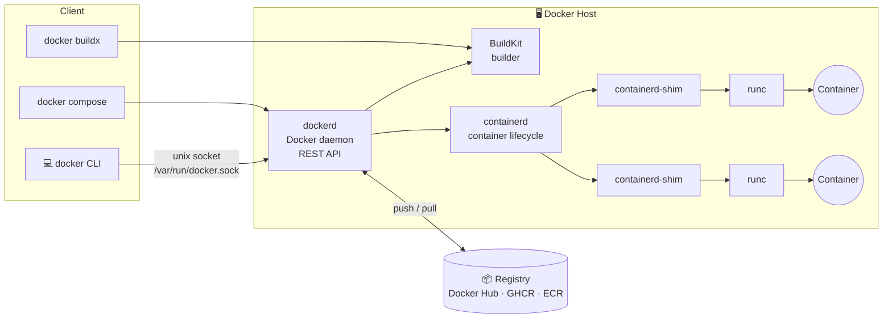
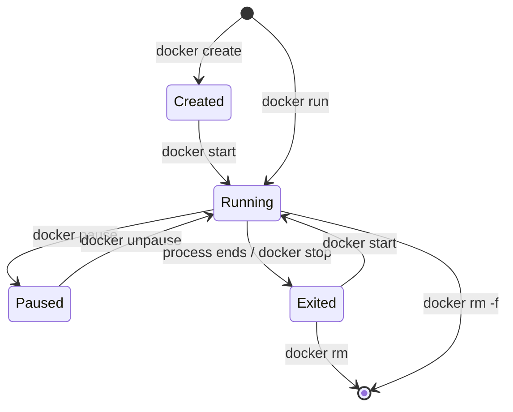

# 01 · Foundations & Architecture 🟢

[← Index](README.md) · [Next: Images & Dockerfile →](02-images-dockerfile.md)

## 🤔 The Problem Docker Solves

```
  "It works on my machine" 😩                  With containers 😎
  ──────────────────────────                   ─────────────────────────────
  Dev laptop:  Node 20, libssl 3               Image = app + runtime + libs
  Staging:     Node 18, libssl 1.1    ───▶     Same image runs on laptop,
  Prod:        Node 16, missing lib            CI, staging and prod
```

A **container** is a normal Linux process that is **isolated** (it gets its own view of files, network and processes) and **limited** (CPU and memory caps), started from a packaged filesystem called an **image**.

## 🏠 Containers vs Virtual Machines

```
        Virtual Machines                          Containers
 ┌──────────┬──────────┬──────────┐    ┌──────────┬──────────┬──────────┐
 │  App A   │  App B   │  App C   │    │  App A   │  App B   │  App C   │
 │  Libs    │  Libs    │  Libs    │    │  Libs    │  Libs    │  Libs    │
 │ Guest OS │ Guest OS │ Guest OS │    ├──────────┴──────────┴──────────┤
 ├──────────┴──────────┴──────────┤    │        Container Runtime        │
 │           Hypervisor            │    ├─────────────────────────────────┤
 ├─────────────────────────────────┤    │   Host OS (one shared kernel)   │
 │            Host OS              │    ├─────────────────────────────────┤
 ├─────────────────────────────────┤    │         Infrastructure          │
 │         Infrastructure          │    └─────────────────────────────────┘
 └─────────────────────────────────┘
```

| | Virtual Machine | Container |
|--|----------------|-----------|
| Isolates | Hardware (full guest OS) | Processes (shared host kernel) |
| Boot time | Tens of seconds to minutes | Milliseconds to seconds |
| Size | GBs | MBs |
| Density | Tens per host | Hundreds per host |
| Isolation strength | Stronger | Weaker (shared kernel), hardened with gVisor or Kata |

> 💡 On macOS and Windows, Docker runs containers inside a small Linux VM, because containers need a Linux kernel.

## 🏛️ Docker Architecture



| Component | Role |
|-----------|------|
| **docker CLI** | Sends your commands to the daemon's API |
| **dockerd** | Manages images, networks, volumes and builds |
| **BuildKit** | The modern build engine (parallel, cached, secret-aware) |
| **containerd** | Industry-standard runtime that manages container lifecycle (Kubernetes uses it too) |
| **runc** | Low-level OCI runtime that actually creates the container, then exits |
| **shim** | Keeps the container running if dockerd or containerd restarts |
| **Registry** | Stores and distributes images |

> 🔐 Access to `docker.sock` is effectively **root on the host**. Guard it.

## 🧱 Image vs Container

```
       IMAGE (read-only layers)                CONTAINER = image + thin writable layer
  ┌──────────────────────────────┐        ┌──────────────────────────────┐
  │                              │        │  ✍️ writable layer (changes)  │ ← lost on rm
  │  L4  COPY app/ .             │        ├──────────────────────────────┤
  │  L3  RUN npm ci              │  run   │  L4  COPY app/ .             │
  │  L2  RUN apt-get install ... │ ─────▶ │  L3  RUN npm ci              │  shared,
  │  L1  base: node:22-slim      │        │  L2  RUN apt-get install ... │  read-only
  │                              │        │  L1  base: node:22-slim      │
  └──────────────────────────────┘        └──────────────────────────────┘
```

- Layers are **content-addressed** (by sha256) and **shared** between images and containers. Ten containers from one image use the disk space of one image plus ten small writable layers.
- Files changed inside a container use **copy-on-write**: the file is copied up into the writable layer first.

## 🔁 Container Lifecycle



## 🏷️ Image Names Decoded

```
  ghcr.io / myorg / api : 1.4.2 @sha256:9f2c...
  ───┬───   ──┬──   ─┬─   ──┬──   ─────┬─────
  registry  namespace repo   tag     digest (immutable, exact)

  nginx          →  docker.io/library/nginx:latest
```

> ⚠️ Tags can be moved to point at a different image. **Digests can't.** Pin by digest in production.

## 📜 Open Standards (OCI)

Docker images and runtimes follow the **Open Container Initiative** specs:

| Spec | Defines | So that... |
|------|---------|-----------|
| Image spec | Layer and manifest format | Images built by Docker run on Podman, Kubernetes, containerd |
| Runtime spec | How to run a container bundle | runc, crun, gVisor, Kata are interchangeable |
| Distribution spec | Registry API | Any registry works with any client |

## ✅ Key Takeaways

- A container is an **isolated, limited process**, not a tiny VM.
- **CLI → dockerd → containerd → runc** is the chain that runs a container.
- An **image** is read-only stacked layers. A **container** adds a writable layer on top.
- Images are identified by `registry/namespace/repo:tag@digest`, so pin the digest.


---

## OCI-compliant runtimes 
```
- they follow the same specification for starting containers, ==> but they offer different levels of performance and security:
```
### 1. Standard Runtimes (Host-Shared Kernel)
These run containers as standard Linux processes. They are fast but share the host kernel.
*   **`runc`**: The industry standard reference implementation. Written in **Go**.
*   **`crun`**: A faster, low-memory alternative to `runc`. Written in **C**. It is the default for tools like Podman.

### 2. Sandboxed Runtimes (Isolated Kernel)
These provide extra security for running untrusted code by preventing the container from talking directly to the host kernel.
*   **`gVisor`**: Developed by Google. It intercepts system calls and runs them in a "user-space kernel" (Sentry). High security, but higher performance overhead for system-call-heavy apps.
*   **`Kata Containers`**: Uses **Lightweight VMs** (via QEMU or Firecracker). Each container gets its own actual kernel. It provides the security of a VM with the management ease of a container.

### Summary Table
| Runtime | Isolation Type | Language | Main Benefit |
| :--- | :--- | :--- | :--- |
| **runc** | Namespaces/Cgroups | Go | Industry standard |
| **crun** | Namespaces/Cgroups | C | Speed & low memory |
| **gVisor** | Syscall Proxy | Go | Security (No host kernel access) |
| **Kata** | Virtual Machine | Rust/Go/C | Hardware-level isolation |