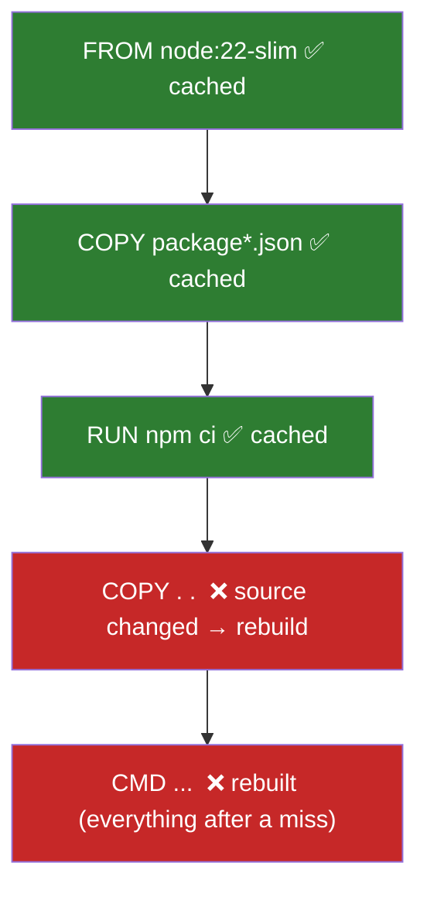
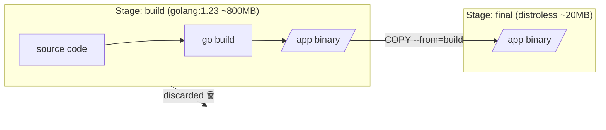

# 02 · Images & Dockerfile 🟢

[← Foundations](01-foundations.md) · [Next: Running Containers →](03-containers.md)

## 📜 Dockerfile: The Recipe

```dockerfile
# syntax=docker/dockerfile:1
FROM node:22-slim                 # base image
WORKDIR /app                      # cd (created if missing)
COPY package*.json ./             # dependency manifest first (cache!)
RUN npm ci --omit=dev             # install → new layer
COPY . .                          # source code
ENV NODE_ENV=production
EXPOSE 3000                       # documentation only, does not publish
USER node                         # don't run as root
CMD ["node", "server.js"]         # default process
```

## 🧰 Instruction Reference

| Instruction | Does | Creates a layer? |
|-------------|------|:---------------:|
| `FROM` | Sets the base image and starts a stage | ✅ (base) |
| `RUN` | Runs a command at build time | ✅ |
| `COPY` / `ADD` | Copies files in (`ADD` also fetches URLs and unpacks tars, so prefer `COPY`) | ✅ |
| `WORKDIR` | Sets the working directory | metadata |
| `ENV` | Env var at build time **and** runtime | metadata |
| `ARG` | Variable at **build time only** (`--build-arg`) | – |
| `EXPOSE` | Documents a port | metadata |
| `USER` | Sets the user for later instructions and runtime | metadata |
| `ENTRYPOINT` | The executable that always runs | metadata |
| `CMD` | Default arguments or command (easy to override) | metadata |
| `HEALTHCHECK` | Command that reports container health | metadata |
| `LABEL` | Key/value metadata (OCI annotations) | metadata |
| `VOLUME` | Marks a path as an anonymous volume | metadata |

### ENTRYPOINT vs CMD

```
  ENTRYPOINT ["python", "app.py"]
  CMD        ["--port", "8000"]

  docker run img                 →  python app.py --port 8000
  docker run img --port 9000     →  python app.py --port 9000     (CMD replaced)
  docker run --entrypoint sh img →  sh                            (ENTRYPOINT replaced)
```

> 💡 Always use the **exec form** `["cmd", "arg"]`. The shell form `cmd arg` wraps your process in `/bin/sh -c`, so it doesn't receive `SIGTERM` and won't stop gracefully.

## 🧅 Layers & the Build Cache



**Rule:** once a layer misses the cache, every layer after it is rebuilt. So order instructions from **least to most frequently changed**.

```
  ❌ Slow                              ✅ Fast
  COPY . .                             COPY package*.json ./
  RUN npm ci     ← reinstalls on       RUN npm ci       ← cached unless deps change
                   every code edit     COPY . .
```

### Keep layers small

```dockerfile
# ❌ the cache files still live in the earlier layer
RUN apt-get update
RUN apt-get install -y curl
RUN rm -rf /var/lib/apt/lists/*

# ✅ one layer, cleaned in the same step
RUN apt-get update \
 && apt-get install -y --no-install-recommends curl \
 && rm -rf /var/lib/apt/lists/*
```

## 🏗️ Multi-Stage Builds

Build with every tool you need, then ship only the result.



```dockerfile
# syntax=docker/dockerfile:1
FROM golang:1.23 AS build
WORKDIR /src
COPY go.mod go.sum ./
RUN go mod download
COPY . .
RUN CGO_ENABLED=0 go build -o /out/app ./cmd/server

FROM gcr.io/distroless/static-debian12:nonroot AS final
COPY --from=build /out/app /app
USER nonroot
ENTRYPOINT ["/app"]
```

```bash
docker build -t api:dev --target build .   # stop at a stage (debug, tests)
```

## 🪶 Choosing a Base Image

```
 Size ▲
 ~1GB │ ███████████████████  node:22 / python:3.13      full Debian, every tool
      │
~200MB│ ██████               node:22-slim               trimmed Debian ✅ good default
      │
 ~50MB│ ██                   node:22-alpine             musl libc ⚠️ compatibility
      │
 ~20MB│ █                    distroless / chainguard    no shell, no package manager 🔒
      │
  ~0MB│ ▏                    scratch                    empty (static binaries only)
      └────────────────────────────────────────────▶ Attack surface ▼
```

## 🙈 .dockerignore

It keeps the **build context** small and stops secrets leaking into the image.

```gitignore
.git
node_modules
dist
*.log
.env
.env.*
Dockerfile*
docker-compose*.yml
```

## 🔨 Build, Tag, Push

```bash
docker build -t myorg/api:1.4.2 -t myorg/api:latest .
docker build -f docker/Dockerfile.prod --build-arg VERSION=1.4.2 .
docker image history myorg/api:1.4.2      # layers and their sizes
docker login ghcr.io
docker tag myorg/api:1.4.2 ghcr.io/myorg/api:1.4.2
docker push ghcr.io/myorg/api:1.4.2
```

> 🔍 Inspect and slim images with **dive** (layer explorer) and **docker scout** (CVEs and base image advice).

## ✅ Key Takeaways

- Each `RUN`/`COPY`/`ADD` makes a layer, and a cache miss rebuilds everything after it.
- Copy dependency manifests **before** the source code.
- Use **multi-stage** builds and a **slim or distroless** base.
- Use the exec form for `CMD`/`ENTRYPOINT`, and always use `.dockerignore`.
