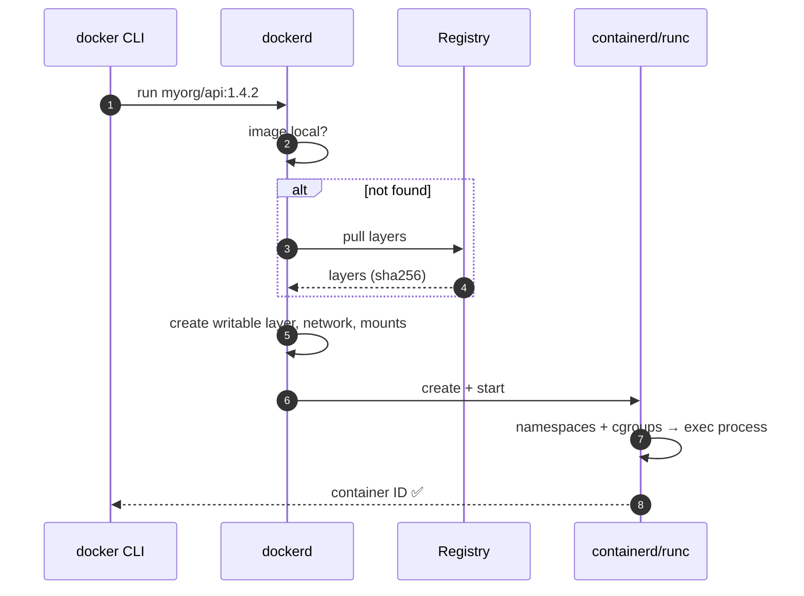

# 03 · Running Containers 🟢

[← Images & Dockerfile](02-images-dockerfile.md) · [Next: Networking →](04-networking.md)

## 🏃 Anatomy of `docker run`

```
docker run -d --name api -p 8080:3000 -e LOG_LEVEL=debug \
           -v data:/app/data --restart unless-stopped \
           --memory 512m --cpus 1.5  myorg/api:1.4.2  node server.js
           │   │           │          │                │
           │   │           │          │                └─ override CMD
           │   │           │          └─ env var
           │   │           └─ host:container port
           │   └─ name instead of a random one
           └─ detached (background)
```

What happens behind the scenes:



## 🚩 Most Useful `run` Flags

| Flag | Purpose |
|------|---------|
| `-d` | Run in the background |
| `-it` | Interactive terminal (`-i` keeps STDIN open, `-t` gives a TTY) |
| `--rm` | Remove the container when it exits |
| `--name` | Human-friendly name |
| `-p 8080:80` | Publish a port (`127.0.0.1:8080:80` = localhost only) |
| `-e` / `--env-file` | Environment variables |
| `-v` / `--mount` | Volumes and bind mounts (ch. 05) |
| `--network` | Attach to a network (ch. 04) |
| `-w` | Working directory |
| `-u 1000:1000` | Run as a user or group |
| `--restart` | Restart policy |
| `--memory`, `--cpus`, `--pids-limit` | Resource limits |
| `--read-only` | Read-only root filesystem |
| `--init` | Tiny init process (reaps zombies, forwards signals) |

## 🔄 Restart Policies

| Policy | Restarts when... |
|--------|------------------|
| `no` (default) | Never |
| `on-failure[:N]` | It exits with a non-zero code (optionally at most N times) |
| `always` | Always, including after the daemon restarts |
| `unless-stopped` | Always, unless you stopped it manually ✅ common choice |

## 📊 Resource Limits (cgroups)

```
 Memory ──────────────────────────────────[ --memory 512m ]──▶ 💀 OOM-killed (exit 137)
 CPU    ───────────[ --cpus 1.5 ]───────────────────────────▶ 🐢 throttled
 PIDs   ──────[ --pids-limit 200 ]──────────────────────────▶ 🚫 fork bomb blocked
```

```bash
docker stats                       # live CPU / memory / network / IO
docker update --memory 1g api      # change limits on a running container
```

## 🔍 Observe & Debug

```bash
docker ps                          # running containers
docker ps -a                       # including exited ones
docker logs -f --tail 100 api      # follow logs (stdout/stderr)
docker exec -it api sh             # shell inside a running container
docker inspect api                 # full JSON (IP, mounts, env, state)
docker inspect -f '{{.State.ExitCode}}' api
docker top api                     # processes inside
docker cp api:/app/log.txt .       # copy files out (or in)
docker diff api                    # files changed vs the image
docker events                      # live daemon events
```

### Exit codes cheat sheet

| Code | Meaning |
|------|---------|
| `0` | Success |
| `1` | App error |
| `125` | The docker command itself failed |
| `126` | Command not executable |
| `127` | Command not found |
| `137` | Killed by SIGKILL, often **OOM** or `docker kill` |
| `143` | Terminated by SIGTERM (graceful `docker stop`) |

## 🛑 Graceful Shutdown

```
docker stop api
   │
   ├─▶ SIGTERM to PID 1 ──▶ app closes connections, flushes data
   │        ⏳ 10s grace period (--stop-timeout / -t)
   └─▶ SIGKILL if still running 💀
```

> ⚠️ PID 1 inside a container doesn't get default signal handlers. If your app ignores `SIGTERM`, use the exec-form `CMD` and `--init` (tini), or handle the signal in code.

## 🧹 Cleanup

```bash
docker rm -f api                   # remove a container
docker container prune             # all stopped containers
docker image prune -a              # unused images
docker system df                   # what uses disk space
docker system prune -a --volumes   # ⚠️ nuke all unused things
```

## ✅ Key Takeaways

- `docker run` = pull if needed + create + start.
- Use `-d`, `--name`, `-p`, `-e`, `--restart unless-stopped` for services, and `--rm -it` for one-off tasks.
- Always set **memory** limits. Exit code `137` usually means OOM.
- Make sure your app handles **SIGTERM** so it shuts down cleanly.
