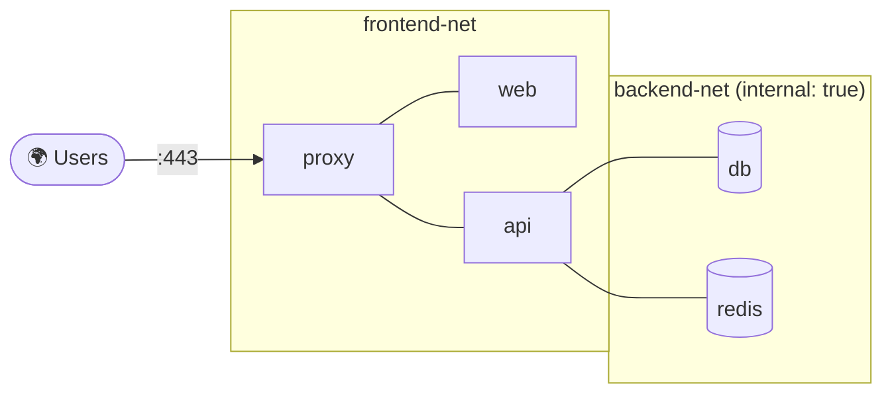

# 04 · Networking 🟡

[← Running Containers](03-containers.md) · [Next: Storage →](05-storage.md)

## 🌐 Network Drivers

| Driver | What it does | Use |
|--------|--------------|-----|
| `bridge` (default) | Private virtual network on one host, NAT to the outside | Most single-host apps |
| **user-defined bridge** | Same, plus **DNS by container name** and better isolation | ✅ Always prefer this |
| `host` | Container shares the host's network stack (no isolation, no NAT) | Max performance, network tools (Linux) |
| `none` | Loopback only | Fully offline jobs |
| `overlay` | Network spanning several hosts | Swarm services |
| `macvlan` / `ipvlan` | Container gets its own address on the physical LAN | Legacy apps that need a real LAN IP |

## 🌉 How Bridge Networking Works

```
                         🌍 Internet
                              ▲
                              │ NAT (iptables / nftables MASQUERADE)
 ┌─────────────────────── Host  eth0 192.168.1.20 ───────────────────────┐
 │                                                                       │
 │   -p 8080:80 ──▶ DNAT ──┐                                             │
 │                         ▼                                             │
 │   ┌──────────── docker0 / br-xxxx bridge  172.18.0.1 ────────────┐    │
 │   │        │veth                 │veth                  │veth    │    │
 │   │  ┌─────┴──────┐       ┌──────┴─────┐        ┌───────┴────┐   │    │
 │   │  │ web        │       │ api        │        │ db         │   │    │
 │   │  │ 172.18.0.2 │ ────▶ │ 172.18.0.3 │ ─────▶ │ 172.18.0.4 │   │    │
 │   │  └────────────┘ "api" └────────────┘  "db"  └────────────┘   │    │
 │   └──────────────────── embedded DNS 127.0.0.11 ─────────────────┘    │
 └───────────────────────────────────────────────────────────────────────┘
```

- Each container gets a **veth pair**: one end inside the container, one end on the bridge.
- **Outbound** traffic is NAT'd through the host IP.
- **Inbound** traffic only arrives through **published ports** (`-p`).

## 🏷️ DNS: Default vs User-Defined Bridge

```bash
# ❌ default bridge: containers can't resolve each other's names
docker run -d --name db postgres:17
docker run --rm alpine ping db        # ping: bad address 'db'

# ✅ user-defined bridge: names resolve automatically
docker network create app-net
docker run -d --name db  --network app-net -e POSTGRES_PASSWORD=x postgres:17
docker run --rm --network app-net alpine ping -c1 db   # 64 bytes from 172.18.0.2 ✅
```

> 💡 Docker Compose creates a user-defined network for each project automatically, so services find each other by **service name**.

## 🔌 Publishing Ports

```
  -p 8080:80              host 0.0.0.0:8080   → container :80   ⚠️ every interface
  -p 127.0.0.1:8080:80    host localhost only → container :80   ✅ safer for dev
  -p 80                   random host port    → container :80   (docker port <c>)
  -P                      publish every EXPOSEd port to random host ports
  -p 5353:53/udp          UDP
```

> ⚠️ Published ports skip many host firewalls such as **UFW**, because Docker writes its own iptables rules. Bind to `127.0.0.1`, or put a reverse proxy in front.

## 🧱 Isolating Tiers with Multiple Networks



```bash
docker network create frontend-net
docker network create --internal backend-net    # no outbound internet
docker network connect backend-net api          # api joins both networks
```

`db` can't be reached from `proxy` or the internet. Only `api` sits on both networks.

## 🛠️ Network Commands

```bash
docker network ls
docker network inspect app-net          # subnet, attached containers
docker network connect / disconnect app-net api
docker run --network host nginx         # share the host stack (Linux)
docker run --network container:api nicolaka/netshoot   # join another container's netns 🔧
```

> 🧰 **netshoot** (`nicolaka/netshoot`) bundles `curl`, `dig`, `tcpdump`, `ss` and more for debugging container networks.

## ✅ Key Takeaways

- Always create a **user-defined network**, which gives you name-based DNS.
- Traffic only comes in through **published ports**. Bind to `127.0.0.1` when you can.
- Split tiers into networks and use `--internal` for backends.
- Use `host` mode for raw performance (Linux only) and `overlay` for multi-host setups.
