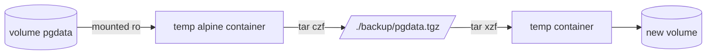

# 05 · Storage 🟡

[← Networking](04-networking.md) · [Next: Docker Compose →](06-compose.md)

## 💨 The Problem: Containers Are Ephemeral

```
docker run --name db postgres      →  writes data to its writable layer
docker rm db                       →  🗑️ writable layer deleted → data GONE
```

Persist anything you care about **outside** the container's writable layer.

## 🗂️ Three Mount Types

```
                ┌──────────────────── Container ────────────────────┐
                │  /var/lib/postgresql/data   /app/src     /tmp     │
                └──────────┬────────────────────┬─────────────┬─────┘
                           │                    │             │
                     ┌─────▼──────┐      ┌──────▼──────┐  ┌───▼────┐
                     │  VOLUME    │      │ BIND MOUNT  │  │ TMPFS  │
                     │ managed by │      │ any host    │  │ RAM    │
                     │ Docker     │      │ path        │  │ only   │
                     └─────┬──────┘      └──────┬──────┘  └────────┘
  Host filesystem:  /var/lib/docker/      ~/projects/app/src
                    volumes/pgdata/_data
```

| | Volume | Bind mount | tmpfs |
|--|--------|-----------|-------|
| Managed by | Docker | You (host path) | Kernel memory |
| Survives `docker rm` | ✅ | ✅ (it's your folder) | ❌ |
| Portable | ✅ | ❌ depends on the host layout | – |
| Performance on Mac/Win | ✅ good | 🐢 slower (file sharing) | ✅ fast |
| Best for | **Databases, app data** | **Dev: live source code**, config files | Secrets, scratch, caches |

## 📦 Volumes

```bash
docker volume create pgdata
docker run -d --name db \
  -e POSTGRES_PASSWORD=secret \
  -v pgdata:/var/lib/postgresql/data \
  postgres:17

docker rm -f db                       # container gone...
docker run -d --name db2 -v pgdata:/var/lib/postgresql/data \
  -e POSTGRES_PASSWORD=secret postgres:17   # ...data still there ✅

docker volume ls
docker volume inspect pgdata
docker volume prune                   # ⚠️ removes unused volumes
```

> 💡 An empty volume mounted on a path that already has files in the image gets **pre-populated** with those files. Bind mounts don't do this: they **hide** whatever was in the image at that path.

## 🔗 Bind Mounts (Development)

```bash
docker run --rm -it \
  -v "$PWD":/app \            # live-edit source on the host
  -v /app/node_modules \      # anonymous volume shields the container's deps
  -w /app -p 5173:5173 node:22 npm run dev
```

### `-v` vs `--mount`

```bash
# short syntax
-v pgdata:/var/lib/postgresql/data
-v "$PWD"/config.yml:/etc/app/config.yml:ro

# explicit syntax (clearer, fails if the source is missing)
--mount type=volume,src=pgdata,dst=/var/lib/postgresql/data
--mount type=bind,src="$PWD"/config.yml,dst=/etc/app/config.yml,readonly
--mount type=tmpfs,dst=/tmp,tmpfs-size=64m
```

> ⚠️ `-v` with a missing host path silently **creates an empty directory**. `--mount` gives you an error instead.

## 🔐 Permissions Gotcha

```
host file owner: uid 1000 (you)
container user:  uid 999 (postgres)  →  Permission denied ❌

Fixes:
  • run as a matching user:      docker run -u $(id -u):$(id -g) ...
  • chown in the Dockerfile:     COPY --chown=app:app . .
  • use named volumes (Docker sets them up from the image's ownership)
  • SELinux hosts: append :z or :Z to the bind mount
```

## 💾 Back Up & Restore a Volume



```bash
# backup
docker run --rm -v pgdata:/data:ro -v "$PWD":/backup alpine \
  tar czf /backup/pgdata.tgz -C /data .

# restore
docker run --rm -v pgdata-new:/data -v "$PWD":/backup alpine \
  tar xzf /backup/pgdata.tgz -C /data
```

> For databases, prefer app-consistent dumps (`pg_dump`, `mysqldump`) over copying raw files while the DB is running.

## 🧬 Storage Drivers (Under the Hood)

Images and writable layers are combined by a **storage driver**, usually **overlay2** (OverlayFS). Newer installs may use the **containerd image store** with snapshotters.

```
  merged/   ← what the container sees
     ▲
  upperdir  (writable layer)        ← copy-on-write target
  lowerdir  L3 : L2 : L1 (image)    ← read-only
```

Heavy write workloads (databases, logs) should go to **volumes**, which bypass copy-on-write.

## ✅ Key Takeaways

- The writable layer is **temporary**. Use **volumes** for data.
- **Bind mounts** for development code and host config files, **tmpfs** for in-memory scratch.
- Prefer `--mount` for clarity, and add `:ro` when a container only needs to read.
- Back up volumes with a throwaway container, or better, with app-native dumps.
