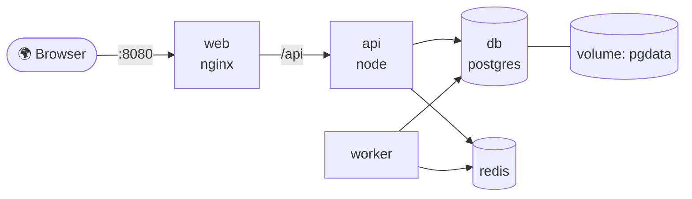

# 06 · Docker Compose 🟡

[← Storage](05-storage.md) · [Next: Security →](07-security.md)

## 🎼 Why Compose?

```
  Without Compose 😵                         With Compose 😌
  docker network create app-net              docker compose up -d
  docker volume create pgdata
  docker run -d --name db --network ...         one YAML file describes
  docker run -d --name redis --network ...      services, networks, volumes,
  docker run -d --name api --network ... -p     env, health and dependencies
  docker run -d --name web --network ... -p
```

## 🗺️ Example App



## 📄 `compose.yaml`

```yaml
# The top-level `version:` key is obsolete, so leave it out.
name: shop

services:
  web:
    image: nginx:1.27-alpine
    ports: ["127.0.0.1:8080:80"]
    volumes: ["./nginx.conf:/etc/nginx/conf.d/default.conf:ro"]
    depends_on: [api]

  api:
    build:
      context: ./api
      target: final
    environment:
      DATABASE_URL: postgres://app:${DB_PASSWORD}@db:5432/shop   # "db" = service name
      REDIS_URL: redis://redis:6379
    depends_on:
      db:    { condition: service_healthy }   # wait until healthy ✅
      redis: { condition: service_started }
    restart: unless-stopped
    deploy:
      resources:
        limits: { memory: 512M, cpus: "1.0" }

  worker:
    build: ./api
    command: ["node", "worker.js"]
    depends_on: [db, redis]
    deploy: { replicas: 2 }

  db:
    image: postgres:17
    environment:
      POSTGRES_USER: app
      POSTGRES_DB: shop
      POSTGRES_PASSWORD: ${DB_PASSWORD}       # from the .env file
    volumes: ["pgdata:/var/lib/postgresql/data"]
    healthcheck:
      test: ["CMD-SHELL", "pg_isready -U app -d shop"]
      interval: 5s
      retries: 10

  redis:
    image: redis:7-alpine

  adminer:
    image: adminer
    ports: ["127.0.0.1:8081:8080"]
    profiles: [debug]                         # only with --profile debug

volumes:
  pgdata:
```

```bash
# .env (same folder, git-ignored) — used for ${VAR} substitution
DB_PASSWORD=change-me
```

## ⏱️ Startup Order with Health Checks

```
 depends_on: [db]                       depends_on: { db: { condition: service_healthy } }
 ─────────────────                      ───────────────────────────────────────────────
 db   ▶ started (still initializing)    db   ▶ started ▶ ...healthcheck... ▶ healthy ✅
 api  ▶ started → 💥 connection refused  api                                 ▶ started ✅
```

## 🧰 Everyday Commands

```bash
docker compose up -d                 # create + start everything
docker compose up -d --build api     # rebuild one service
docker compose ps
docker compose logs -f api
docker compose exec api sh
docker compose run --rm api npm test # one-off command
docker compose up -d --scale worker=4
docker compose --profile debug up -d # include profiled services
docker compose config                # final merged YAML (debug interpolation)
docker compose down                  # stop + remove containers and networks
docker compose down -v               # ⚠️ also removes volumes (data!)
```

## 🧱 Layering Files per Environment

```
compose.yaml            ← base (shared)
compose.override.yaml   ← loaded automatically → dev tweaks (bind mounts, debug ports)
compose.prod.yaml       ← used explicitly in prod
```

```bash
docker compose up -d                                      # base + override
docker compose -f compose.yaml -f compose.prod.yaml up -d # base + prod
```

You can also pull in other files with the top-level `include:` key.

## 👀 Watch Mode (Fast Dev Loop)

```yaml
services:
  api:
    build: ./api
    develop:
      watch:
        - action: sync           # copy changed files into the container
          path: ./api/src
          target: /app/src
        - action: rebuild        # deps changed → rebuild the image
          path: ./api/package.json
```

```bash
docker compose watch
```

## 🧭 Compose vs Kubernetes

| | Compose | Kubernetes |
|--|---------|-----------|
| Scope | One host | A cluster of hosts |
| Best for | Local dev, CI, small single-server deploys | Production at scale, HA |
| Self-healing across nodes | ❌ | ✅ |
| Learning curve | Low | High |

## ✅ Key Takeaways

- One `compose.yaml` holds the whole app. Services reach each other by **service name**.
- Use `depends_on` + `condition: service_healthy` for a reliable startup order.
- Put secrets in `.env` (git-ignored), and use **profiles** for optional tools.
- Use **override files** per environment and `compose watch` for hot reload.
