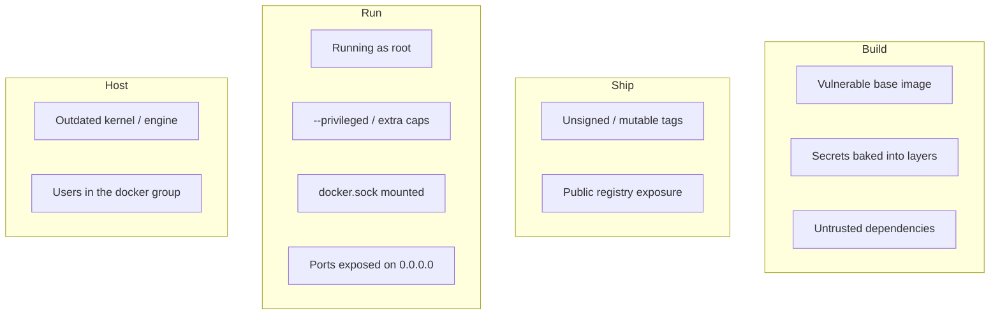
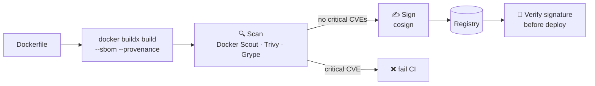

# 07 · Security 🔴

[← Docker Compose](06-compose.md) · [Next: Advanced Topics →](08-advanced.md)

## 🧱 How Isolation Works

```
                 ┌─────────────── one container process ───────────────┐
 Namespaces  ──▶ │ pid  net  mnt  uts  ipc  user  cgroup              │  what it can SEE
 cgroups     ──▶ │ memory · cpu · pids · io                            │  what it can USE
 Capabilities──▶ │ a small subset of root powers                       │  what it can DO
 seccomp     ──▶ │ ~40+ dangerous syscalls blocked by default          │  which syscalls
 AppArmor/   ──▶ │ mandatory access control profile                    │  which files/ops
 SELinux         └──────────────────────────────────────────────────────┘
                              ▼
                   🐧 shared host kernel  ← a kernel exploit = container escape
```

## 🎯 Attack Surface Map



## 👤 Don't Run as Root

```dockerfile
FROM node:22-slim
WORKDIR /app
COPY --chown=node:node . .
RUN npm ci --omit=dev
USER node                     # ✅ uid 1000, not 0
CMD ["node", "server.js"]
```

```bash
docker run --rm myimg id      # uid=1000(node) ✅
```

## 🔒 A Hardened `docker run`

```bash
docker run -d --name api \
  --user 10001:10001 \
  --read-only --tmpfs /tmp:size=64m \
  --cap-drop ALL --cap-add NET_BIND_SERVICE \
  --security-opt no-new-privileges:true \
  --memory 512m --cpus 1 --pids-limit 200 \
  -p 127.0.0.1:8080:8080 \
  myorg/api@sha256:9f2c...
```

| Flag | Protects against |
|------|------------------|
| `--user` | Root inside the container mapping to powerful host operations |
| `--read-only` | Attackers writing binaries or tampering with files |
| `--cap-drop ALL` | Abuse of raw sockets, chown, mount and similar powers |
| `no-new-privileges` | setuid binaries escalating privileges |
| Limits | DoS, fork bombs, noisy neighbors |
| Digest pin | Tag hijacking or silent image changes |

### 🚫 Red flags

```
--privileged                 → almost full host access
-v /var/run/docker.sock:...  → root on the host
-v /:/host                   → the host filesystem
--pid host / --network host  → removes isolation
--cap-add SYS_ADMIN          → "the new root"
```

## 🤫 Secrets: Never in the Image

```dockerfile
# ❌ stays in layer history forever (even if deleted later)
ENV API_KEY=abc123
COPY .npmrc .
ARG GITHUB_TOKEN               # visible in `docker history`

# ✅ BuildKit secret mount: available during this RUN only, never stored
RUN --mount=type=secret,id=npmrc,target=/root/.npmrc npm ci
```

```bash
docker build --secret id=npmrc,src=$HOME/.npmrc .
```

At runtime, use **Compose secrets** (mounted at `/run/secrets/<name>`), your orchestrator's secret store, or Vault or a cloud secret manager. Don't use plain env vars for highly sensitive values.

```yaml
services:
  api:
    secrets: [db_password]
secrets:
  db_password:
    file: ./secrets/db_password.txt
```

## 🔍 Supply Chain: Scan, Sign, Verify



```bash
docker scout cves myorg/api:1.4.2
trivy image myorg/api:1.4.2
cosign sign ghcr.io/myorg/api@sha256:9f2c...
cosign verify ghcr.io/myorg/api@sha256:9f2c... --certificate-identity=... --certificate-oidc-issuer=...
```

## 🧑‍💻 Host & Daemon Hardening

| Measure | Why |
|---------|-----|
| **Rootless mode** (`dockerd-rootless-setuptool.sh install`) | The daemon and containers run as an unprivileged user |
| **userns-remap** | Root in the container maps to an unprivileged host uid |
| Keep the `docker` group tiny | Membership = root-equivalent |
| Never expose the TCP API without TLS | `tcp://0.0.0.0:2375` = instant takeover |
| Keep the engine and kernel updated | Escapes are usually kernel or runtime CVEs |
| Stronger sandboxes | **gVisor** (`runsc`), **Kata Containers** for untrusted code |
| Audit | **Docker Bench for Security**, CIS Docker Benchmark |

## ✅ Security Checklist

- [ ] Minimal or distroless base, rebuilt regularly
- [ ] `USER` set to a non-root uid
- [ ] No secrets in `ENV`, `ARG` or `COPY`; use BuildKit secret mounts
- [ ] `.dockerignore` excludes `.env`, `.git` and keys
- [ ] Images scanned in CI, signed, deployed **by digest**
- [ ] `--read-only`, `--cap-drop ALL`, `no-new-privileges`, resource limits
- [ ] No `--privileged`, no `docker.sock` mounts
- [ ] Ports bound to `127.0.0.1` or behind a proxy
- [ ] Rootless or userns-remap, engine and kernel patched
