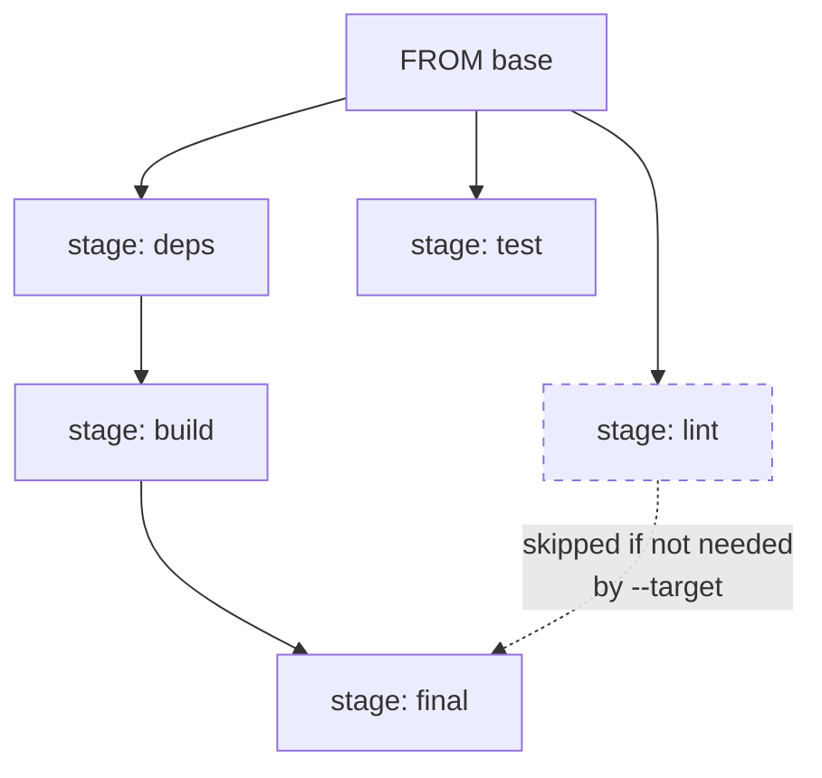
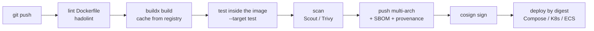

# 08 · Advanced Topics 🔴

[← Security](07-security.md) · [Next: Cheatsheet →](09-cheatsheet.md)

## ⚡ BuildKit Superpowers

BuildKit is the default builder. It builds stages **in parallel**, skips unused stages and supports special mounts.



### Cache mounts: keep package caches between builds

```dockerfile
# syntax=docker/dockerfile:1
FROM python:3.13-slim
WORKDIR /app
COPY requirements.txt .
RUN --mount=type=cache,target=/root/.cache/pip \
    pip install -r requirements.txt          # 🚀 re-downloads nothing

FROM golang:1.23 AS build
RUN --mount=type=cache,target=/go/pkg/mod \
    --mount=type=cache,target=/root/.cache/go-build \
    --mount=type=bind,target=. \
    go build -o /out/app ./cmd/server
```

| Mount type | Purpose |
|-----------|---------|
| `type=cache` | Persistent package or compiler cache across builds |
| `type=secret` | Secret file for one `RUN` only, never stored in a layer |
| `type=ssh` | Forward your SSH agent (private git repos) |
| `type=bind` | Read the build context without `COPY`ing it into a layer |

### Remote cache in CI

```bash
docker buildx build \
  --cache-from type=registry,ref=ghcr.io/myorg/api:buildcache \
  --cache-to   type=registry,ref=ghcr.io/myorg/api:buildcache,mode=max \
  -t ghcr.io/myorg/api:1.4.2 --push .
# GitHub Actions: --cache-from/to type=gha
```

## 🌍 Multi-Architecture Images

One tag serves both Intel/AMD (`amd64`) and ARM (`arm64`: Apple Silicon, Graviton, Raspberry Pi).

```
           ghcr.io/myorg/api:1.4.2   (manifest list / OCI index)
                         │
          ┌──────────────┼──────────────┐
          ▼              ▼              ▼
   linux/amd64     linux/arm64     linux/arm/v7
   sha256:aa11     sha256:bb22     sha256:cc33
          ▲
   docker pull picks the right one for the host automatically
```

```bash
docker buildx create --name multi --use        # builder with multi-platform support
docker buildx build --platform linux/amd64,linux/arm64 \
  -t ghcr.io/myorg/api:1.4.2 --push .
docker buildx imagetools inspect ghcr.io/myorg/api:1.4.2
```

> 🐢 Emulating another architecture (QEMU) is slow. For compiled languages, **cross-compile** using `--platform=$BUILDPLATFORM` with `TARGETOS`/`TARGETARCH`:

```dockerfile
FROM --platform=$BUILDPLATFORM golang:1.23 AS build
ARG TARGETOS TARGETARCH
RUN GOOS=$TARGETOS GOARCH=$TARGETARCH go build -o /out/app .
```

### Bake: declarative builds

```hcl
# docker-bake.hcl
group "default" { targets = ["api", "worker"] }
target "api"    { context = "./api"    tags = ["ghcr.io/myorg/api:latest"]    platforms = ["linux/amd64","linux/arm64"] }
target "worker" { context = "./worker" tags = ["ghcr.io/myorg/worker:latest"] }
```

```bash
docker buildx bake --push
```

## 🔬 Internals: Build a "Container" by Hand

```
 unshare --pid --fork --mount-proc --uts --net --mount  ← new namespaces
   └─ chroot ./rootfs /bin/sh                            ← new filesystem root
        + cgroup: echo $$ > /sys/fs/cgroup/demo/cgroup.procs
          echo 100M > /sys/fs/cgroup/demo/memory.max     ← limits
 ─────────────────────────────────────────────────────────
 ≈ what runc does (plus capabilities, seccomp, pivot_root, overlayfs)
```

```bash
docker inspect -f '{{.State.Pid}}' api          # container's PID on the host
sudo ls -l /proc/<pid>/ns                       # its namespaces
sudo nsenter -t <pid> -n ss -tlnp               # run a host tool in its net namespace
```

## 📦 Registries

| Registry | Notes |
|----------|-------|
| Docker Hub | Default. Pull rate limits for anonymous and free users |
| GHCR (`ghcr.io`) | Tied to GitHub repos and Actions |
| ECR / GAR / ACR | Cloud native, IAM auth |
| Harbor | Self-hosted, with scanning, replication and signing |
| `registry:2` | Minimal self-hosted, good for labs and caching mirrors |

```bash
docker run -d -p 5000:5000 --name registry registry:2
docker tag api localhost:5000/api && docker push localhost:5000/api
```

## 🔁 CI/CD Pipeline



### Tagging strategy

```
ghcr.io/myorg/api:1.4.2          ← immutable release (semver)
ghcr.io/myorg/api:1.4            ← moves to the latest patch
ghcr.io/myorg/api:sha-9f2c1ab    ← exact commit ✅ traceable
ghcr.io/myorg/api:main           ← moving branch tag (dev/staging)
❌ avoid deploying :latest to production
```

## 🏭 Production Patterns

| Concern | Practice |
|---------|----------|
| Logs | Write to **stdout/stderr**. Set the log driver with rotation (`json-file` `max-size`/`max-file`, or `local`) |
| Health | `HEALTHCHECK` in the image, or probes in the orchestrator |
| Config | 12-factor: env vars plus mounted config, one image for every environment |
| PID 1 | Use `--init` / tini, handle `SIGTERM`, add a graceful drain timeout |
| Monitoring | cAdvisor + Prometheus + Grafana, Docker metrics endpoint |
| Reverse proxy | Traefik or Caddy with automatic TLS in front of containers |
| Multi-host | **Kubernetes** (most common), Docker Swarm (simple, built in), Nomad, ECS, Cloud Run |

```json
// /etc/docker/daemon.json
{
  "log-driver": "local",
  "log-opts": { "max-size": "10m", "max-file": "3" },
  "live-restore": true,
  "default-ulimits": { "nofile": { "Name": "nofile", "Soft": 65536, "Hard": 65536 } }
}
```

## 🐝 Swarm in 30 Seconds

```bash
docker swarm init
docker stack deploy -c compose.yaml shop     # Compose file → services across nodes
docker service ls
docker service scale shop_api=5
```

## 🧪 Beyond Docker

| Tool | Why look at it |
|------|----------------|
| **Podman** | Daemonless and rootless by default, pods, `podman generate kube` |
| **nerdctl** | Docker-compatible CLI straight on containerd |
| **Buildah / Kaniko / BuildKit standalone** | Build images without a Docker daemon (in CI or Kubernetes) |
| **Dev Containers** | Reproducible dev environments from `devcontainer.json` (VS Code, Codespaces) |
| **Testcontainers** | Throwaway real dependencies (DBs, Kafka) in integration tests |
| **WebAssembly runtimes** | Experimental Wasm workloads alongside containers |

## ✅ Key Takeaways

- **BuildKit** cache, secret and bind mounts make builds fast and safe. Use a registry or GHA cache in CI.
- **buildx** builds **multi-arch** images. Cross-compile instead of emulating.
- Containers are namespaces + cgroups + overlayfs, and `nsenter` lets you look inside.
- Ship with a pipeline: **lint → build → test → scan → sign → deploy by digest**.
