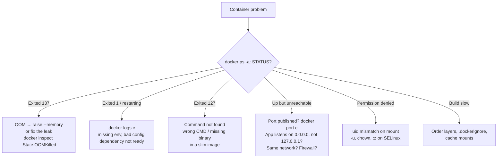

# 09 · Docker CLI Cheatsheet 📎

[← Advanced Topics](08-advanced.md) · [Back to Index](README.md)

## 🧭 Command Shape

```
docker  <object>   <verb>     [flags]     <target>
docker  container  ls         -a
docker  image      prune      -a
docker  network    create                 app-net
        (short forms: docker ps, docker images, docker rmi, docker rm)
```

## 🖼️ Images

```bash
docker build -t app:1.0 .                    # build
docker build --no-cache --pull -t app:1.0 .  # fresh build, newest base
docker images / docker image ls
docker pull nginx:1.27
docker tag app:1.0 ghcr.io/me/app:1.0
docker push ghcr.io/me/app:1.0
docker image history app:1.0                 # layers
docker image inspect app:1.0
docker rmi app:1.0
docker save app:1.0 | gzip > app.tgz         # export for offline transfer
docker load < app.tgz
```

## 📦 Containers

```bash
docker run -d --name web -p 8080:80 nginx    # start a service
docker run --rm -it ubuntu bash              # throwaway shell
docker ps / docker ps -a
docker stop web / docker start web / docker restart web
docker rm -f web
docker logs -f --since 10m web
docker exec -it web sh
docker inspect web
docker stats
docker cp web:/etc/nginx/nginx.conf .
docker container prune
```

## 🌐 Networks & 💾 Volumes

```bash
docker network create app-net
docker network ls / inspect app-net
docker network connect app-net web
docker volume create data
docker volume ls / inspect data
docker run -v data:/data -v "$PWD":/src:ro --mount type=tmpfs,dst=/tmp ...
docker volume prune
```

## 🎼 Compose

```bash
docker compose up -d [--build]
docker compose ps
docker compose logs -f [svc]
docker compose exec svc sh
docker compose run --rm svc cmd
docker compose restart svc
docker compose pull
docker compose config
docker compose watch
docker compose down [-v]
```

## 🏗️ Buildx

```bash
docker buildx ls
docker buildx create --name multi --use
docker buildx build --platform linux/amd64,linux/arm64 -t me/app:1.0 --push .
docker buildx bake
docker buildx du / docker buildx prune       # build cache usage / cleanup
```

## 🧹 Disk Cleanup

```bash
docker system df                 # what's using space
docker image prune -a            # unused images
docker builder prune             # build cache
docker system prune -a --volumes # ⚠️ everything unused, including volumes
```

## 🩻 Troubleshooting Flow



## 🎨 Formatting Output

```bash
docker ps --format 'table {{.Names}}\t{{.Status}}\t{{.Ports}}'
docker inspect -f '{{range .NetworkSettings.Networks}}{{.IPAddress}}{{end}}' web
docker images --filter dangling=true -q
docker ps -q | xargs docker stop             # stop all running
```

## 🧰 Handy Tools

| Tool | What it does |
|------|--------------|
| **lazydocker** | Terminal UI for containers, logs and stats ⭐ |
| **dive** | Explore image layers and wasted space |
| **hadolint** | Dockerfile linter |
| **ctop** | `top` for containers |
| **Docker Scout / Trivy** | Vulnerability scanning |
| **nicolaka/netshoot** | Network debugging toolbox image |
| **Portainer** | Web UI for Docker and Swarm |

## 📋 Dockerfile Template

```dockerfile
# syntax=docker/dockerfile:1
FROM node:22-slim AS deps
WORKDIR /app
COPY package*.json ./
RUN --mount=type=cache,target=/root/.npm npm ci

FROM deps AS build
COPY . .
RUN npm run build

FROM node:22-slim AS final
WORKDIR /app
ENV NODE_ENV=production
COPY --from=deps  --chown=node:node /app/node_modules ./node_modules
COPY --from=build --chown=node:node /app/dist ./dist
USER node
EXPOSE 3000
HEALTHCHECK CMD node -e "fetch('http://localhost:3000/health').then(r=>process.exit(r.ok?0:1)).catch(()=>process.exit(1))"
CMD ["node", "dist/server.js"]
```
