# 🐳 Docker: Foundations to Advanced

A short, illustrated guide to Docker, from "what is a container?" to multi-stage builds, multi-arch images and production hardening.
Each chapter is a summary: diagrams first, then the key ideas, then the commands and files you actually write.

> Diagrams use **Mermaid** (rendered by GitHub, GitLab, Obsidian and VS Code with the Mermaid extension) and plain ASCII art.

## 🗺️ Learning Path

```mermaid
flowchart LR
    A[01 Foundations<br/>Containers & Architecture] --> B[02 Images<br/>Dockerfile & Layers]
    B --> C[03 Containers<br/>Run & Manage]
    C --> D[04 Networking<br/>Bridges & Ports]
    D --> E[05 Storage<br/>Volumes & Mounts]
    E --> F[06 Compose<br/>Multi-container apps]
    F --> G[07 Security<br/>Hardening]
    G --> H[08 Advanced<br/>BuildKit · Multi-arch · Internals]
    H --> I[09 Cheatsheet]

    style A fill:#1d63ed,color:#fff
    style B fill:#1d63ed,color:#fff
    style C fill:#1d63ed,color:#fff
    style D fill:#3b7af0,color:#fff
    style E fill:#3b7af0,color:#fff
    style F fill:#3b7af0,color:#fff
    style G fill:#0b3fa8,color:#fff
    style H fill:#0b3fa8,color:#fff
    style I fill:#555,color:#fff
```



## 📚 Chapters

| # | Chapter | Level | You will learn |
|---|---------|-------|----------------|
| 01 | [Foundations & Architecture](01-foundations.md) | 🟢 Beginner | Containers vs VMs, how the Docker engine is built, image vs container |
| 02 | [Images & Dockerfile](02-images-dockerfile.md) | 🟢 Beginner | Layers, instructions, build cache, multi-stage builds |
| 03 | [Running Containers](03-containers.md) | 🟢 Beginner | Lifecycle, `run` flags, logs, exec, limits, restart policies |
| 04 | [Networking](04-networking.md) | 🟡 Intermediate | Bridge, host, none, user-defined networks, ports, DNS |
| 05 | [Storage](05-storage.md) | 🟡 Intermediate | Volumes, bind mounts, tmpfs, backups |
| 06 | [Docker Compose](06-compose.md) | 🟡 Intermediate | Multi-service apps, health checks, profiles, watch mode |
| 07 | [Security](07-security.md) | 🔴 Advanced | Non-root, capabilities, secrets, rootless, scanning, signing |
| 08 | [Advanced Topics](08-advanced.md) | 🔴 Advanced | BuildKit, multi-arch, registries, internals, CI/CD, production |
| 09 | [CLI Cheatsheet](09-cheatsheet.md) | 📎 Reference | The commands you will use every day |

## 🧠 The One Idea to Remember

```
   ┌──────────────┐   docker build   ┌──────────────┐   docker run   ┌──────────────┐
   │  Dockerfile  │ ───────────────▶ │    IMAGE     │ ─────────────▶ │  CONTAINER   │
   │   (recipe)   │                  │ (read-only   │                │ (running     │
   │              │                  │  template)   │ ◀── push/pull ─│  instance)   │
   └──────────────┘                  └──────┬───────┘                └──────────────┘
                                            │ docker push
                                            ▼
                                     ┌──────────────┐
                                     │   REGISTRY   │  Docker Hub, GHCR, ECR...
                                     └──────────────┘
```

**Recipe → template → running instance.** One image can start any number of identical containers, on any machine with a container runtime.

## 🧪 Install & Verify

```bash
docker version           # client + server (engine) versions
docker run --rm hello-world
docker info              # storage driver, cgroups, runtimes
```

| Platform | Option |
|----------|--------|
| Linux | Docker Engine (native) or rootless mode |
| macOS / Windows | Docker Desktop, OrbStack (macOS), Rancher Desktop, Colima |
| Daemonless alternative | Podman (mostly CLI-compatible) |
