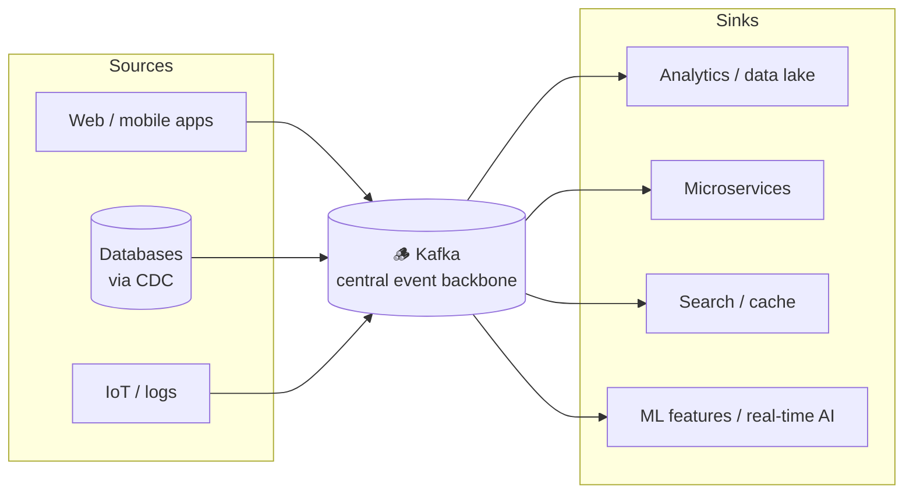
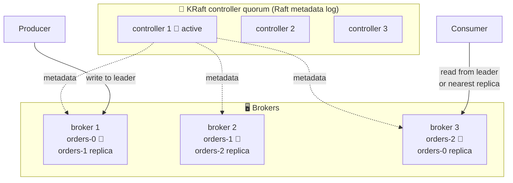
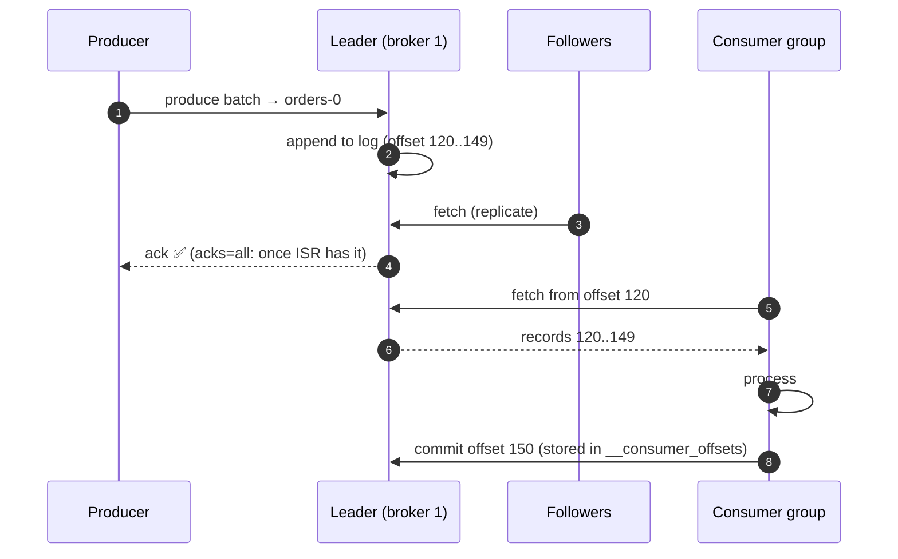

# 01 · Foundations 🟢

[← Index](README.md) · [Next: Producers →](02-producers.md)

## 🌊 What Is Event Streaming?

```
  Databases store STATE           Kafka stores EVENTS (what happened, in order)
  ─────────────────────           ───────────────────────────────────────────────
  account 42: balance = 70        t1 AccountOpened(42)
                                  t2 Deposited(42, 100)
                                  t3 Withdrew(42, 30)       → replay = balance 70
                                  ...and every service can react to each event
```



## 🧱 Core Concepts

| Concept | What it is |
|---------|-----------|
| **Event / record** | Key + value + timestamp + headers |
| **Topic** | Named stream of events (like a table, but append-only) |
| **Partition** | An ordered, immutable log. Topics are split into partitions for scale |
| **Offset** | Position of a record within a partition (0, 1, 2, ...) |
| **Broker** | A Kafka server that stores partitions and serves clients |
| **Cluster** | Several brokers working together |
| **Producer** | Writes events to topics |
| **Consumer / consumer group** | Reads events. A group shares the work of a topic |
| **Controller (KRaft)** | Manages cluster metadata and leader election |

## 🗂️ Topics, Partitions & Offsets

```
 topic: orders   (3 partitions)

 partition 0 │ 0 │ 1 │ 2 │ 3 │ 4 │ 5 │ 6 │ ← append
 partition 1 │ 0 │ 1 │ 2 │ 3 │ ← append
 partition 2 │ 0 │ 1 │ 2 │ 3 │ 4 │ 5 │ ← append

 ✔ ordering is guaranteed WITHIN a partition, not across partitions
 ✔ same key → same partition → per-key ordering (e.g. all events of order #42)
 ✔ records are immutable; offsets only grow
```

## 🏛️ Cluster Architecture (KRaft)



- Since **Kafka 4.0, ZooKeeper is gone**. Metadata lives in an internal Raft log managed by **KRaft controllers**.
- Every partition has **one leader** and N−1 **followers** (replicas on other brokers).
- Clients bootstrap from any broker, fetch **metadata**, then talk **directly to partition leaders**.
- Small clusters can run in **combined mode** (broker + controller in one process). Production usually uses dedicated controllers.

## 📨 Anatomy of a Record

```
 ┌──────────────────── record ────────────────────┐
 │ key:       "order-42"          → partitioning  │
 │ value:     {"status":"PAID","total":99.5}       │
 │ timestamp: 2026-11-18T10:15:02Z                 │
 │ headers:   trace-id=ab12, source=checkout       │
 └─────────────────────────────────────────────────┘
   stored as bytes → serialize with JSON / Avro / Protobuf (+ Schema Registry)
```

## 🔁 Basic Flow



## 🎯 Why Kafka Is Fast

| Trick | Effect |
|-------|--------|
| **Sequential disk I/O** (append-only log) | Disks are fast when writing sequentially |
| **OS page cache** | Recent data is served from RAM without a JVM heap copy |
| **Zero-copy** (`sendfile`) | Disk → socket without passing through user space |
| **Batching + compression** | Fewer, larger network requests |
| **Partitioning** | Parallelism across brokers and consumers |
| **Dumb broker, smart client** | The broker doesn't track per-message state |

## 🧩 Typical Use Cases

```
 📊 Activity tracking & analytics      🔄 CDC: DB → Kafka → search / warehouse
 🧾 Event sourcing / audit log         🤝 Microservice choreography (events)
 📜 Log & metrics aggregation          ⚡ Stream processing (fraud, alerts)
 🤖 Real-time features for ML / AI     🌍 Data mesh / platform backbone
```

## ✅ Key Takeaways

- Kafka is a **distributed, replicated, append-only log**.
- **Topic → partitions → offsets**. Ordering holds **per partition**, so use keys for per-entity order.
- Reading doesn't delete. Consumers track **offsets** and can **replay**.
- Kafka 4.x runs on **KRaft**, with no ZooKeeper.
