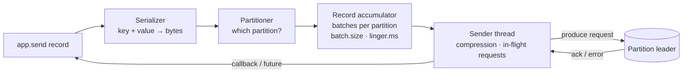
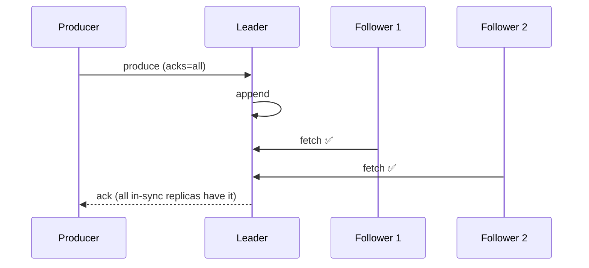

# 02 · Producers 🟢

[← Foundations](01-foundations.md) · [Next: Consumers →](03-consumers.md)

## 🏭 Inside a Producer



## 🎯 Partitioning

```
  key = "order-42"  → hash(key) % numPartitions = 1  → always partition 1 ✅ per-key order
  key = null        → sticky partitioner: fills one batch, then switches (good batching)
  custom            → implement a Partitioner (e.g. by tenant or region)
```

```
 topic: orders (3 partitions)

 order-42 events ──▶ P1 │ created │ paid │ shipped │   ✔ in order
 order-77 events ──▶ P0 │ created │ cancelled │
 order-91 events ──▶ P2 │ created │ paid │
```

> ⚠️ **Adding partitions changes `hash % n`**, so existing keys move to new partitions and per-key ordering breaks around the change. Pick the partition count up front, generously.

### Choosing keys

| Good key | Why |
|----------|-----|
| `orderId`, `userId`, `deviceId` | Per-entity ordering + even spread |
| ❌ `country` | **Hot partitions** (most traffic in one key) |
| ❌ Constant key | Everything lands in one partition, no parallelism |

## ✅ Acknowledgements (`acks`)

```
 acks=0    Producer ──▶ 🔥 fire & forget            fastest, may lose data
 acks=1    Producer ──▶ Leader ✅                    lost if the leader dies before replicating
 acks=all  Producer ──▶ Leader + all ISR ✅✅✅        ⭐ durable (default since Kafka 3.0)
```



Combine with `min.insync.replicas=2` on the topic (ch. 04) for true durability.

## 🔂 Idempotent Producer (No Duplicates on Retry)

```
 Without idempotence:                       With enable.idempotence=true (default):
 send m1 → leader writes → ack lost 🌩️       send m1 [PID=7, seq=0] → written, ack lost
 retry m1 → written AGAIN → duplicate ❌      retry  [PID=7, seq=0] → broker: seen seq 0 → drop ✅
```

- Each producer gets a **Producer ID**, and each record a **sequence number** per partition.
- The broker drops duplicates and keeps **order** even with retries and multiple in-flight requests (≤ 5).
- Gives **exactly-once writes per partition per producer session**. Cross-partition atomicity needs **transactions** (ch. 05).

## 📦 Batching & Compression (Throughput)

```
  linger.ms=0     │m│ │m│ │m│ │m│      many tiny requests 🐢
  linger.ms=10    │m m m m m m m m│    one big compressed batch 🚀
                  └── batch.size (e.g. 64–256 KB) ──┘
```

| Setting | Effect | Typical value |
|---------|--------|---------------|
| `batch.size` | Max bytes per partition batch | 64 KB – 1 MB for throughput |
| `linger.ms` | Wait to fill batches (default 5 ms in newer clients) | 5–50 ms |
| `compression.type` | `lz4` / `zstd` / `snappy` / `gzip` | `lz4` or `zstd` ⭐ |
| `buffer.memory` | Total producer buffer | 32 MB+ |
| `max.in.flight.requests.per.connection` | Pipelining | ≤ 5 (with idempotence) |
| `delivery.timeout.ms` | Upper bound for send + retries | 120 s default |

```
 latency ◀────────────────────────────────────────────▶ throughput
 linger.ms=0, small batches                 linger.ms=20, big batches, zstd
```

## 💻 Code

### Java

```java
Properties p = new Properties();
p.put("bootstrap.servers", "localhost:9092");
p.put("key.serializer",   "org.apache.kafka.common.serialization.StringSerializer");
p.put("value.serializer", "org.apache.kafka.common.serialization.StringSerializer");
p.put("acks", "all");
p.put("enable.idempotence", "true");
p.put("compression.type", "zstd");
p.put("linger.ms", "10");

try (var producer = new KafkaProducer<String, String>(p)) {
    var rec = new ProducerRecord<>("orders", "order-42", "{\"status\":\"PAID\"}");
    producer.send(rec, (meta, ex) -> {
        if (ex != null) log.error("send failed", ex);
        else log.info("written to {}-{}@{}", meta.topic(), meta.partition(), meta.offset());
    });
}
```

### Python (confluent-kafka)

```python
from confluent_kafka import Producer

p = Producer({"bootstrap.servers": "localhost:9092", "acks": "all",
              "enable.idempotence": True, "compression.type": "zstd", "linger.ms": 10})

def on_delivery(err, msg):
    print("❌", err) if err else print(f"✅ {msg.topic()}[{msg.partition()}]@{msg.offset()}")

p.produce("orders", key="order-42", value='{"status":"PAID"}', on_delivery=on_delivery)
p.flush()
```

## ⚠️ Producer Pitfalls

| Pitfall | Fix |
|---------|-----|
| Ignoring send errors | Always handle the callback or future |
| Creating a producer per message | One long-lived, thread-safe producer per app |
| Huge messages (> 1 MB default) | Claim-check pattern (store in S3, send a reference), or raise `max.request.size` + `message.max.bytes` carefully |
| Not calling `flush()`/`close()` at shutdown | Buffered records lost |
| Dual write: DB + Kafka | Transactional outbox / CDC (ch. 05) |

## ✅ Key Takeaways

- The **key decides the partition**, which decides ordering. Choose keys for even spread.
- `acks=all` + **idempotence** (both default) + `min.insync.replicas=2` = durable, no duplicates on retry.
- Tune `linger.ms`, `batch.size` and `compression.type` (lz4 or zstd) for throughput.
- Use one producer per app, and always handle delivery callbacks.
