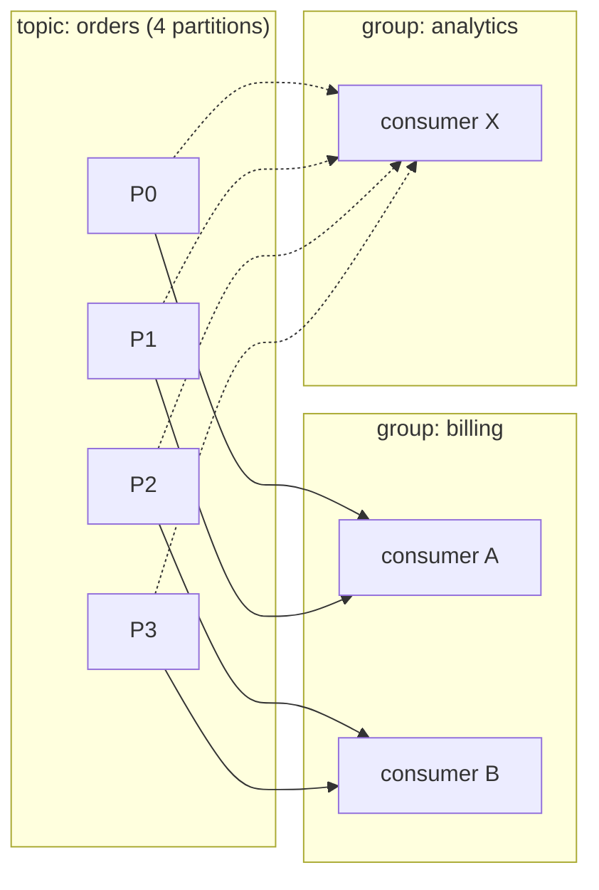
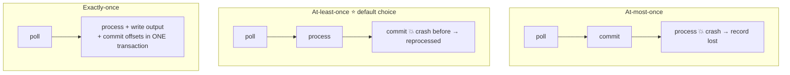
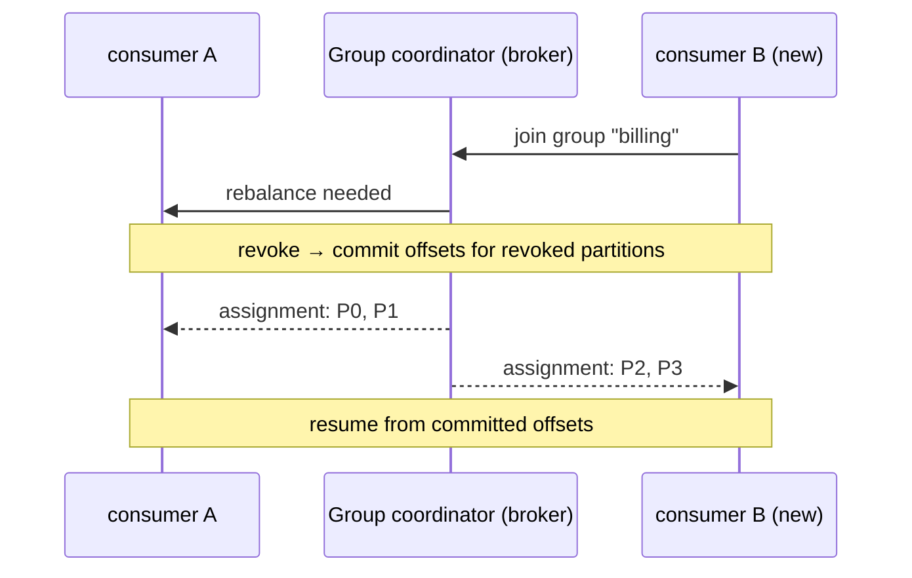
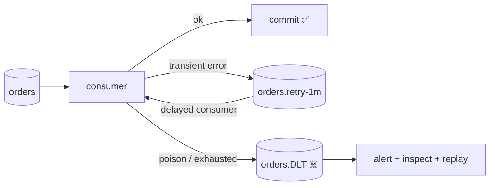

# 03 · Consumers 🟡

[← Producers](02-producers.md) · [Next: Storage & Replication →](04-storage-replication.md)

## 👥 Consumer Groups

A **consumer group** shares a topic's partitions. **Each partition is read by exactly one consumer in the group.**



- **Different groups** each get **every** event (pub/sub).
- **Within a group**, partitions are split up (queue-like load balancing).

### Parallelism is capped by the partition count

```
 4 partitions, 2 consumers → 2 partitions each        ✅
 4 partitions, 4 consumers → 1 partition each         ✅ max parallelism
 4 partitions, 6 consumers → 2 consumers IDLE 😴      ❌ add partitions to scale further
```

> 💡 **Share groups** ("Queues for Kafka", KIP-932) are a newer Kafka feature that lets several consumers share one partition with per-record acks, for queue-style work without the partition cap.

## 📍 Offsets & Commits

```
 partition 0:  │ 0 │ 1 │ 2 │ 3 │ 4 │ 5 │ 6 │ 7 │ 8 │ 9 │
                              ▲               ▲       ▲
                    committed offset = 4   current    log end offset (LEO) = 10
                    (restart resumes here) position
                                           ◀── consumer LAG = 10 − 4 = 6 ──▶
```

- Committed offsets live in the internal topic **`__consumer_offsets`**.
- The committed offset is the **next record to read**.
- `auto.offset.reset` applies when there is no committed offset: `earliest` (from the beginning) or `latest` (only new records, the default).

### Commit strategies & delivery semantics



| Setting | Behavior |
|---------|----------|
| `enable.auto.commit=true` (default) | Commits every `auto.commit.interval.ms` during `poll()`. Simple, but can commit before processing finishes when async |
| `enable.auto.commit=false` + `commitSync()` / `commitAsync()` | ✅ You commit **after** processing. At-least-once |
| Transactions (`sendOffsetsToTransaction`) | Exactly-once for consume → process → produce (ch. 05) |

> 🧾 At-least-once ⇒ **idempotent processing** (upserts, dedupe by key/event ID).

## 🔄 Rebalancing

When consumers join, leave or crash, or partitions change, partitions get **reassigned**.



| Protocol / assignor | Behavior |
|---------------------|----------|
| Eager (old range/round-robin) | **Stop-the-world**: everyone revokes everything 🛑 |
| Cooperative sticky | Incremental: only moved partitions pause ✅ |
| **New consumer protocol (KIP-848)**, `group.protocol=consumer` | Broker-driven, incremental, far fewer disruptions ⭐ (GA in Kafka 4.0) |
| Static membership (`group.instance.id`) | Restarts within `session.timeout.ms` don't trigger a rebalance (good for Kubernetes rolling deploys) |

### Liveness settings

```
 heartbeat.interval.ms   ── "I'm alive"           (background thread)
 session.timeout.ms      ── no heartbeat → kicked out
 max.poll.interval.ms    ── no poll() for this long → considered stuck → kicked out ⚠️
 max.poll.records        ── fewer records per poll = shorter processing loops
```

> ⚠️ Slow processing between `poll()` calls is the #1 cause of **rebalance storms**. Lower `max.poll.records`, or hand work off carefully while keeping commit order.

## 💻 Code

### Java: at-least-once loop

```java
Properties p = new Properties();
p.put("bootstrap.servers", "localhost:9092");
p.put("group.id", "billing");
p.put("enable.auto.commit", "false");
p.put("auto.offset.reset", "earliest");
p.put("group.protocol", "consumer");      // KIP-848 rebalance protocol
p.put("key.deserializer",   StringDeserializer.class.getName());
p.put("value.deserializer", StringDeserializer.class.getName());

try (var consumer = new KafkaConsumer<String, String>(p)) {
    consumer.subscribe(List.of("orders"));
    while (running) {
        var records = consumer.poll(Duration.ofMillis(500));
        for (var r : records) handle(r);          // idempotent!
        consumer.commitSync();                    // after processing ✅
    }
}
```

### Python (confluent-kafka)

```python
from confluent_kafka import Consumer

c = Consumer({"bootstrap.servers": "localhost:9092", "group.id": "billing",
              "enable.auto.commit": False, "auto.offset.reset": "earliest"})
c.subscribe(["orders"])
try:
    while True:
        msg = c.poll(1.0)
        if msg is None: continue
        if msg.error(): print(msg.error()); continue
        handle(msg.key(), msg.value())
        c.commit(message=msg, asynchronous=False)
finally:
    c.close()          # leaves the group cleanly → fast rebalance
```

## ☠️ Error Handling (No DLQ Built In)



Kafka doesn't redeliver single records. If one record keeps failing, it **blocks the partition**. Spring Kafka, Kafka Connect and others provide **retry topics + a dead-letter topic (DLT)**.

## 📏 Lag: The Key Health Metric

```bash
kafka-consumer-groups.sh --bootstrap-server localhost:9092 --describe --group billing
# TOPIC   PARTITION  CURRENT-OFFSET  LOG-END-OFFSET  LAG  CONSUMER-ID
# orders  0          1040            1042            2    consumer-A
# orders  1          990             5600            4610 ⚠️ consumer-A
```

Growing lag = consumers can't keep up. Scale consumers (up to the partition count), optimize processing, or add partitions.

## ✅ Key Takeaways

- **One partition → one consumer per group**. Groups give pub/sub, and members give load balancing.
- Commit **after** processing (at-least-once) and make processing **idempotent**.
- Prefer the **new consumer protocol (KIP-848)** or cooperative-sticky + static membership to reduce rebalance pain.
- Watch **consumer lag**. Use retry topics + a DLT for poison records.
