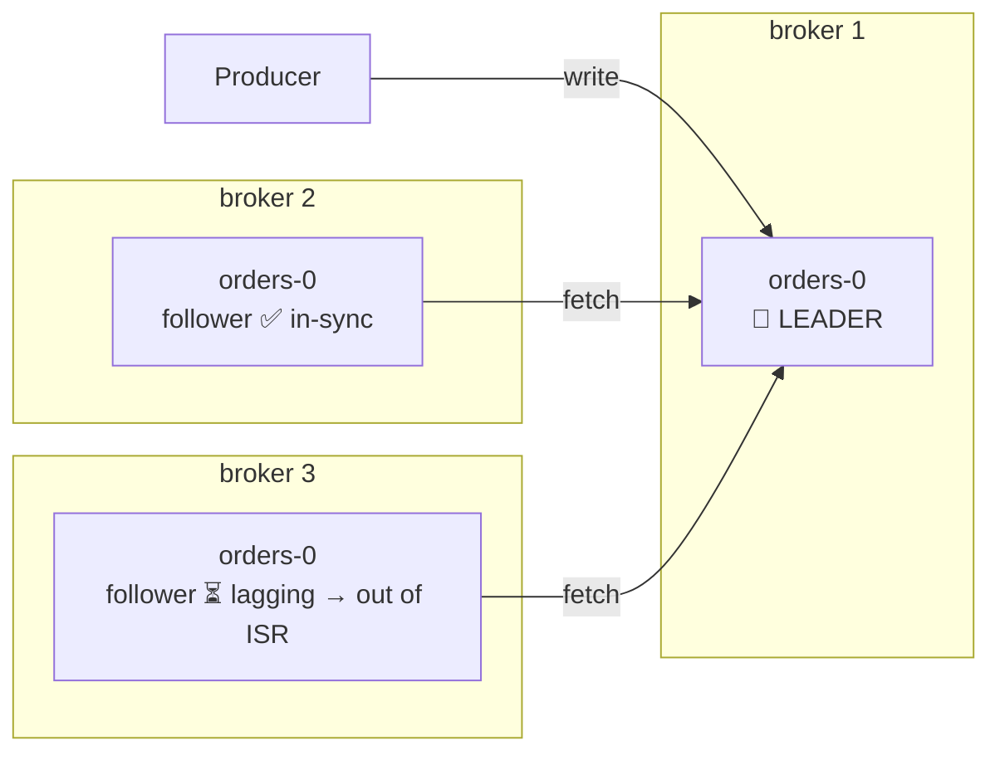
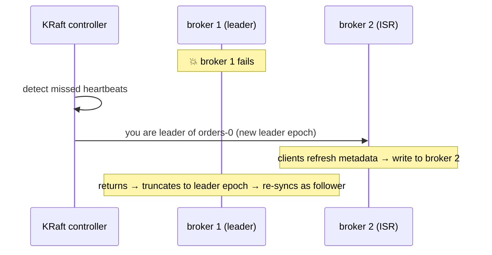

# 04 · Storage & Replication 🟡

[← Consumers](03-consumers.md) · [Next: Ecosystem & Exactly-Once →](05-ecosystem.md)

## 🗄️ How a Partition Is Stored

```
 /var/lib/kafka/data/orders-0/
 ├── 00000000000000000000.log        ← segment (records)          ┐
 ├── 00000000000000000000.index      ← offset → byte position     │ closed segments
 ├── 00000000000000000000.timeindex  ← timestamp → offset         ┘ (deletable / compactable)
 ├── 00000000000005242880.log        ← ACTIVE segment (appending) ✍️
 ├── 00000000000005242880.index
 └── leader-epoch-checkpoint
```

```
 partition = sequence of segments
 ┌──────────────┬──────────────┬──────────────┬─────────────┐
 │ seg 0        │ seg 5242880  │ seg 9876543  │ active ✍️    │
 │ (old)        │              │              │             │
 └──────────────┴──────────────┴──────────────┴─────────────┘
   ▲ retention deletes whole segments from the oldest end
   segment rolls at segment.bytes (1 GB) or segment.ms
```

## 🧹 Cleanup Policies

### `cleanup.policy=delete` (default): time or size retention

```
 retention.ms = 7 days      retention.bytes = per-partition cap (-1 = unlimited)

 day: 1   2   3   4   5   6   7   8   9
     [s1][s2][s3][s4][s5][s6][s7][s8][s9]
      🗑️  🗑️                               ← segments older than 7 days removed
```

### `cleanup.policy=compact`: keep the **latest value per key**

```
 before compaction                         after compaction
 offset key   value                        offset key   value
 0      u1    {name: Ann}                  3      u2    {name: Bob v2}
 1      u2    {name: Bob}                  4      u1    {name: Ann v3}
 2      u1    {name: Ann v2}               5      u3    null  ← tombstone (deleted later)
 3      u2    {name: Bob v2}
 4      u1    {name: Ann v3}
 5      u3    null (tombstone = delete)
```

Use compaction for **changelogs and state**: user profiles, config, Kafka Streams state, `__consumer_offsets`, CDC tables. You can also combine both: `cleanup.policy=compact,delete`.

## 🔁 Replication



| Term | Meaning |
|------|---------|
| **Replication factor (RF)** | Copies of each partition (production: **3**) |
| **Leader** | Handles all writes (and reads by default) |
| **Followers** | Fetch from the leader to stay in sync |
| **ISR** (in-sync replicas) | Replicas that caught up within `replica.lag.time.max.ms` |
| **High watermark (HW)** | Highest offset replicated to all ISR. Consumers only see up to the HW |
| **ELR** (eligible leader replicas, newer KRaft feature) | Tracks replicas safe to elect even after shrinking the ISR |

### High watermark

```
 leader     │0│1│2│3│4│5│6│7│      LEO = 8
 follower A │0│1│2│3│4│5│          LEO = 6
 follower B │0│1│2│3│4│5│6│        LEO = 7
                        ▲
            HW = 6 → consumers can read offsets 0..5 (committed data only)
```

## 🛡️ The Durability Triangle

```
           replication.factor = 3
                    ▲
                   ╱ ╲
                  ╱   ╲
   acks = all ───╱─────╲─── min.insync.replicas = 2

 → a write is acked only when ≥ 2 replicas have it
 → tolerates losing 1 broker with NO data loss and writes still accepted
 → if ISR drops below 2 → producers get NotEnoughReplicas (safe failure, not silent loss)
```

| RF | min.insync | Survive broker loss for writes | Data-loss safety |
|:--:|:--:|:--:|:--:|
| 1 | 1 | ❌ | ❌ |
| 3 | 1 | 2 brokers | ⚠️ weak (one copy acked) |
| 3 | **2** ⭐ | 1 broker | ✅ |
| 3 | 3 | 0 | ✅ but fragile |

> ⚠️ Keep `unclean.leader.election.enable=false` (default). Turning it on lets an out-of-sync replica become leader: you get availability at the cost of **data loss**.

## 👑 Leader Election & Rack Awareness



- `broker.rack=az-1|az-2|az-3` spreads replicas **across availability zones**.
- `client.rack` + **follower fetching** lets consumers read from the **nearest replica** (saves cross-AZ costs).

## ☁️ Tiered Storage

```
 ┌── Broker local disk (hot) ──┐     ┌──── Object storage (cold) ────┐
 │ recent segments, fast reads │ ──▶ │ S3 / GCS / Azure Blob          │
 │ local.retention.ms = 1 day  │     │ retention.ms = 1 year, cheap   │
 └─────────────────────────────┘     └────────────────────────────────┘
   ✔ smaller, cheaper brokers   ✔ faster rebalancing/recovery   ✔ long replay history
```

Enable with `remote.log.storage.system.enable=true` (broker) and `remote.storage.enable=true` (topic). A remote storage plugin is required.

## 📐 Partition Count Guidance

```
 partitions ≈ max(target throughput / per-partition producer throughput,
                  target throughput / per-partition consumer throughput)

 ✔ more partitions = more parallelism
 ✘ too many = more open files, slower failover, more metadata (KRaft handles far more than ZooKeeper did)
 rule of thumb: start with 6–12 for busy topics, plan for growth (you can't lower the count later)
```

## ✅ Key Takeaways

- Partitions are **segment files**. Retention deletes old segments, and **compaction** keeps the latest value per key.
- **RF=3 + `min.insync.replicas=2` + `acks=all`** is the production durability baseline.
- Consumers only see data up to the **high watermark**. Never enable unclean leader election for critical data.
- Use **rack awareness** across AZs and **tiered storage** for cheap long retention.
