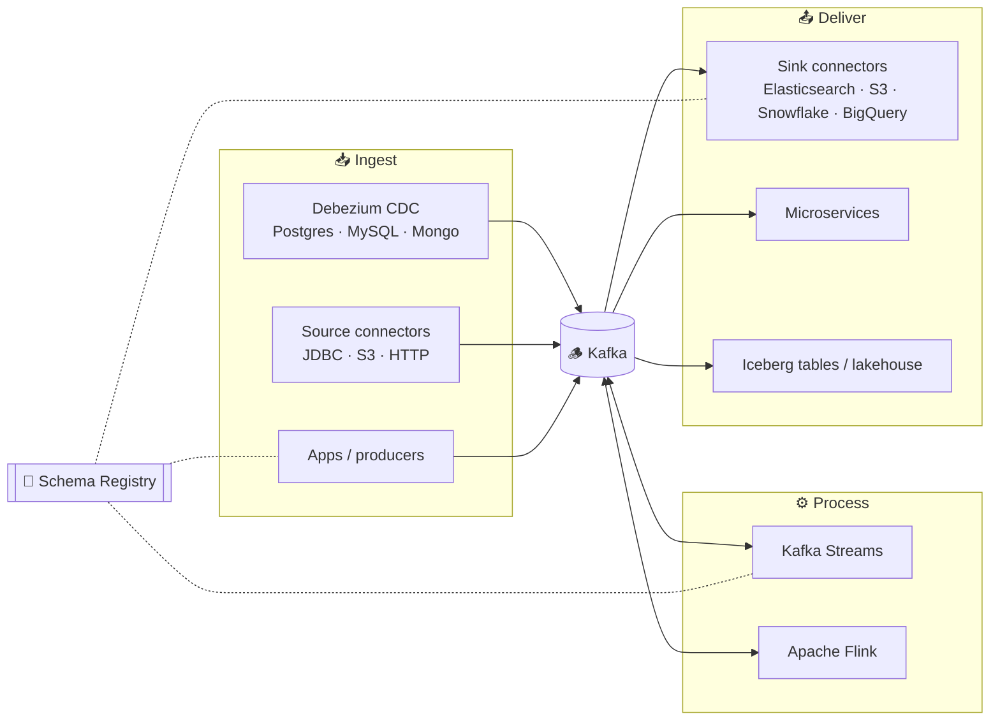
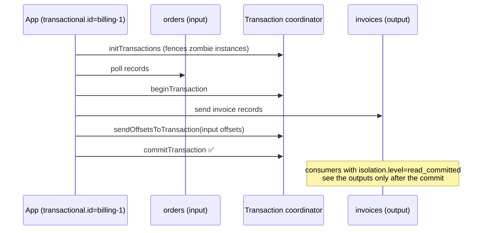

# 05 · Ecosystem & Exactly-Once 🔴

[← Storage & Replication](04-storage-replication.md) · [Next: Operations & Security →](06-operations-security.md)

## 🗺️ The Kafka Ecosystem



## 🔌 Kafka Connect: Integration Without Code

```
 ┌──────────── Connect cluster (distributed workers) ────────────┐
 │  connector: pg-orders-source   →  tasks: t0 t1               │
 │  connector: es-orders-sink     →  tasks: t0 t1 t2            │
 │  config/offsets/status stored in Kafka topics (fault tolerant) │
 └────────────────────────────────────────────────────────────────┘
   Source:  external system ──▶ Kafka        Sink:  Kafka ──▶ external system
   SMTs (single message transforms): rename, mask, route, add fields
   errors.tolerance=all + errors.deadletterqueue.topic.name → DLQ for bad records
```

```json
{
  "name": "pg-orders-cdc",
  "config": {
    "connector.class": "io.debezium.connector.postgresql.PostgresConnector",
    "database.hostname": "postgres",
    "database.dbname": "shop",
    "database.user": "debezium",
    "database.password": "${file:/secrets/pg.properties:password}",
    "topic.prefix": "shop",
    "table.include.list": "public.orders,public.outbox",
    "plugin.name": "pgoutput"
  }
}
```

```bash
curl -X POST -H 'Content-Type: application/json' --data @pg-orders-cdc.json localhost:8083/connectors
curl localhost:8083/connectors/pg-orders-cdc/status
```

## 🔄 CDC + Outbox: Reliable Events from a Database

```mermaid
sequenceDiagram
    participant API as Order service
    participant DB as Postgres
    participant DZ as Debezium
    participant K as Kafka
    API->>DB: BEGIN; INSERT order; INSERT outbox(event); COMMIT
    DZ->>DB: read WAL (logical replication)
    DZ->>K: publish OrderCreated (from outbox row)
    Note over API,K: no dual write → no lost or phantom events ✅
```

## 📜 Schema Registry & Data Contracts

```
 Producer ──(1) register/lookup schema──▶ Schema Registry  (id = 17)
    │
    └──(2) send [magic byte][schema id 17][avro/protobuf bytes] ──▶ Kafka
                                                                   │
 Consumer ◀─(3) fetch schema 17 to deserialize ◀───────────────────┘
```

| Compatibility mode | Allowed change | Upgrade order |
|--------------------|----------------|---------------|
| `BACKWARD` (default) | Delete fields, add optional fields | Consumers first |
| `FORWARD` | Add fields, delete optional fields | Producers first |
| `FULL` | Only add or remove optional fields | Any order |
| `NONE` | Anything goes ❌ | Pain |

> Formats: **Avro** (compact, schema evolution), **Protobuf** (typed, gRPC-friendly), **JSON Schema**. Registries include Confluent Schema Registry, Apicurio and Karapace.

## 🌊 Stream Processing

### Kafka Streams (a library inside your app)

```java
StreamsBuilder b = new StreamsBuilder();

KStream<String, Order> orders = b.stream("orders");
KTable<String, Customer> customers = b.table("customers");      // compacted topic

orders.filter((k, o) -> o.total() > 100)
      .join(customers, (o, c) -> enrich(o, c))                  // stream-table join
      .groupBy((k, e) -> e.country())
      .windowedBy(TimeWindows.ofSizeWithNoGrace(Duration.ofMinutes(5)))
      .count()                                                   // state store (RocksDB)
      .toStream()
      .to("big-orders-per-country-5m");
```

```
 KStream  = every event (insert-only)        "Ann bought X", "Ann bought Y"
 KTable   = latest value per key (upsert)    "Ann → address v3"
 state stores are backed up to compacted changelog topics → fault tolerant
 scale = run more app instances (partitions are split across them)
```

### Windowing

```
 Tumbling (5m)     |■■■■■|■■■■■|■■■■■|          fixed, non-overlapping
 Hopping (5m/1m)   |■■■■■|
                     |■■■■■|                    overlapping
                       |■■■■■|
 Session (gap 30s) |■■■|   |■■■■■■|  |■|        activity bursts per key
```

| | Kafka Streams | Apache Flink |
|--|---------------|-------------|
| Deployment | Library in your JVM app | Separate cluster / job manager |
| Sources | Kafka only | Kafka + many others |
| Best for | Microservices, event-driven apps | Large-scale analytics, complex event processing, SQL |
| SQL | via ksqlDB | Flink SQL ⭐ |

## 🎯 Exactly-Once Semantics (EOS)

**Consume → process → produce atomically**: output records **and** consumer offsets commit together, or not at all.



| Piece | Setting |
|-------|---------|
| Producer | `transactional.id=<stable unique id>` (implies idempotence) |
| Consumer of outputs | `isolation.level=read_committed` |
| Kafka Streams | Just set `processing.guarantee=exactly_once_v2` ✨ |

> ⚠️ EOS covers **Kafka → Kafka**. Side effects outside Kafka (HTTP calls, DB writes) still need idempotency or the outbox pattern.

## 🏗️ Event-Driven Architecture Patterns

| Pattern | Idea |
|---------|------|
| **Event notification** | "OrderPlaced" happened, and interested services react |
| **Event-carried state transfer** | Events carry the full state, so consumers keep local copies (no sync calls) |
| **Event sourcing** | The log of events *is* the source of truth, and state is derived |
| **CQRS** | Write model emits events, read models are built from them |
| **Saga (choreography)** | Multi-step business transactions via events + compensations |
| **Stream-table duality** | A table is a snapshot of a stream, and a stream is a table's changelog |

## ✅ Key Takeaways

- **Connect** moves data in and out (Debezium for CDC). **Schema Registry** enforces contracts.
- **Kafka Streams** (library) or **Flink** (cluster) for real-time processing: joins, windows, aggregations.
- **EOS** = transactional producer + `read_committed`, or `exactly_once_v2` in Streams.
- Use the **outbox + CDC** to publish reliably from databases.
