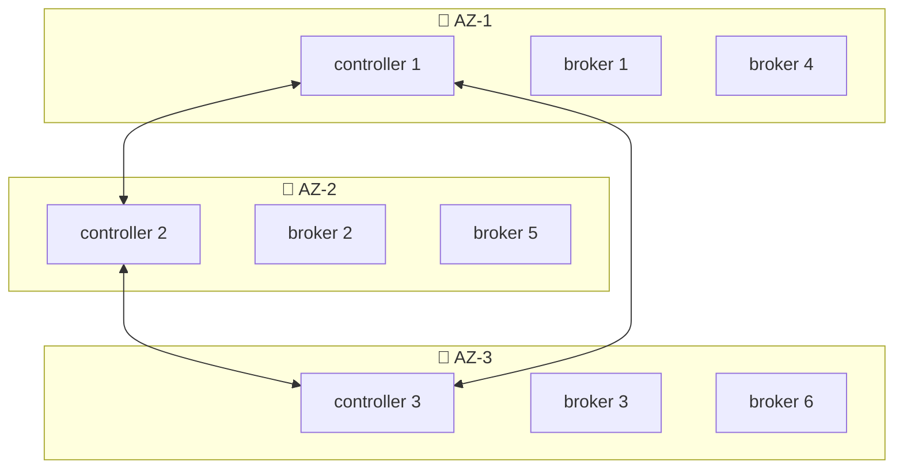
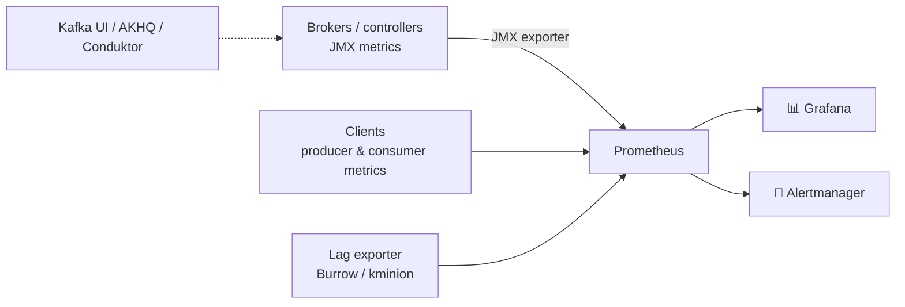

# 06 · Operations & Security 🔴

[← Ecosystem & Exactly-Once](05-ecosystem.md) · [Next: Cheatsheet →](07-cheatsheet.md)

## 🏗️ Production Topology



| Component | Guidance |
|-----------|----------|
| Controllers | **3** (or 5) dedicated KRaft controllers, small machines |
| Brokers | ≥ 3, spread across AZs with `broker.rack` |
| Disks | Fast SSD/NVMe, XFS. Use JBOD or RAID10. Avoid network filesystems |
| Memory | Modest JVM heap (6–8 GB), **leave the rest to the page cache** |
| Network | Often the bottleneck. Replication multiplies traffic (RF× in, consumers× out) |
| Defaults | `default.replication.factor=3`, `min.insync.replicas=2`, `auto.create.topics.enable=false` |

### Deployment options

| Option | Notes |
|--------|-------|
| **Strimzi** (Kubernetes operator) ⭐ | `Kafka`, `KafkaNodePool`, `KafkaTopic`, `KafkaUser` CRDs, KRaft, rolling upgrades |
| VMs / bare metal | Ansible, full control |
| Managed | Confluent Cloud, Amazon MSK, Aiven, Redpanda (Kafka API-compatible), WarpStream |

## 🔭 Monitoring



| Metric | Healthy | Alert when |
|--------|---------|------------|
| `UnderReplicatedPartitions` | 0 | > 0 for minutes |
| `UnderMinIsrPartitionCount` | 0 | > 0 (producers with acks=all are failing!) |
| `OfflinePartitionsCount` | 0 | > 0 🚨 data unavailable |
| `ActiveControllerCount` | exactly 1 in the cluster | 0 or > 1 |
| **Consumer lag** (records / time) | Stable, low | Growing steadily |
| Request latency p99 (Produce/Fetch) | Stable | Spikes |
| `RequestHandlerAvgIdlePercent`, network idle % | > 30% | < 20% (saturated) |
| Disk usage | < 70% | Filling up (retention or tiered storage) |
| ISR shrink/expand rate | ~0 | Flapping |

## ⚙️ Tuning Cheat Sheet

```
 THROUGHPUT 🚀                                LATENCY ⚡
 producer: linger.ms 10–50, batch.size 256K+   producer: linger.ms 0–5, small batches
           compression zstd / lz4                        compression lz4 or none
 consumer: fetch.min.bytes ↑, fetch.max.wait   consumer: fetch.min.bytes=1
           max.poll.records ↑
 broker:   num.network.threads / num.io.threads sized to cores and disks
```

| Durability ✅ | Availability ⚖️ |
|------------|--------------|
| `acks=all`, `min.insync.replicas=2`, RF=3 | Same, plus enough brokers and AZs |
| `unclean.leader.election.enable=false` | Raise `min.insync` only if you can tolerate rejected writes |

## 🔐 Security

```
 ┌──────────────────── Security layers ─────────────────────┐
 │ 🔒 Encryption   TLS for client↔broker and broker↔broker   │
 │ 🪪 AuthN        SASL/SCRAM-SHA-512 · mTLS · SASL/OAUTHBEARER (OIDC) · Kerberos
 │ 📜 AuthZ        ACLs (StandardAuthorizer in KRaft)         │
 │ 🧾 Quotas       produce/fetch byte rates, request rate     │
 │ 🧪 Data         schema validation, PII masking (SMTs), encryption at the field level
 └──────────────────────────────────────────────────────────────┘
```

### Listeners

```properties
listeners=INTERNAL://:9092,EXTERNAL://:9094,CONTROLLER://:9093
advertised.listeners=INTERNAL://broker-1.internal:9092,EXTERNAL://kafka-1.example.com:9094
listener.security.protocol.map=INTERNAL:SASL_SSL,EXTERNAL:SASL_SSL,CONTROLLER:SSL
inter.broker.listener.name=INTERNAL
sasl.enabled.mechanisms=SCRAM-SHA-512
authorizer.class.name=org.apache.kafka.metadata.authorizer.StandardAuthorizer
allow.everyone.if.no.acl.found=false
```

> 🧠 `advertised.listeners` is the **#1 connectivity gotcha**: it's the address brokers hand back to clients, so clients must be able to resolve and reach it.

### ACLs (least privilege)

```bash
# order-service may write to orders
kafka-acls.sh --bootstrap-server kafka:9092 --command-config admin.properties \
  --add --allow-principal User:order-service --operation Write --topic orders

# billing may read orders as consumer group "billing"
kafka-acls.sh ... --add --allow-principal User:billing --operation Read --topic orders
kafka-acls.sh ... --add --allow-principal User:billing --operation Read --group billing
```

## 🐳 Local KRaft Cluster with Docker Compose

```yaml
services:
  kafka:
    image: apache/kafka:latest
    ports: ["127.0.0.1:9092:9092"]
    environment:
      KAFKA_NODE_ID: 1
      KAFKA_PROCESS_ROLES: broker,controller           # combined mode (dev only)
      KAFKA_LISTENERS: PLAINTEXT://:9092,CONTROLLER://:9093
      KAFKA_ADVERTISED_LISTENERS: PLAINTEXT://localhost:9092
      KAFKA_CONTROLLER_LISTENER_NAMES: CONTROLLER
      KAFKA_LISTENER_SECURITY_PROTOCOL_MAP: CONTROLLER:PLAINTEXT,PLAINTEXT:PLAINTEXT
      KAFKA_CONTROLLER_QUORUM_VOTERS: 1@kafka:9093
      KAFKA_OFFSETS_TOPIC_REPLICATION_FACTOR: 1
      KAFKA_TRANSACTION_STATE_LOG_REPLICATION_FACTOR: 1
      KAFKA_TRANSACTION_STATE_LOG_MIN_ISR: 1
    volumes: ["kafka-data:/var/lib/kafka/data"]

  kafka-ui:
    image: provectuslabs/kafka-ui:latest
    ports: ["127.0.0.1:8080:8080"]
    environment:
      KAFKA_CLUSTERS_0_NAME: local
      KAFKA_CLUSTERS_0_BOOTSTRAPSERVERS: kafka:9092
    depends_on: [kafka]

volumes:
  kafka-data:
```

> Inside the Compose network, other containers can't use `localhost:9092`. For that, add a second listener such as `INTERNAL://kafka:29092`.

## 🔄 Day-2 Operations

| Task | How |
|------|-----|
| Add brokers | Start them, then **reassign partitions** (`kafka-reassign-partitions.sh`) or use Cruise Control for automatic balancing |
| Rolling restart / upgrade | One broker at a time, wait for `UnderReplicatedPartitions = 0`, then bump `metadata.version` once everything is upgraded |
| ZooKeeper → KRaft | Migrate on **3.x** (bridge release) **before** moving to 4.x |
| Disaster recovery | **MirrorMaker 2** (or cluster linking) to a secondary region, with offset translation |
| Topic hygiene | Topics as code (Strimzi `KafkaTopic`, Terraform, JulieOps), naming such as `<domain>.<entity>.<event>.v1` |
| Capacity | Track bytes in/out per broker, disk growth, partition count per broker |

## ✅ Key Takeaways

- **3 controllers + ≥ 3 brokers across AZs**. Give memory to the page cache. `auto.create.topics.enable=false`.
- Alert on **under-replicated, under-min-ISR and offline partitions**, and on **consumer lag**.
- Secure with **TLS + SASL (SCRAM/OAuth) + ACLs**, and get `advertised.listeners` right.
- Run on Kubernetes with **Strimzi**, rebalance with Cruise Control, and replicate across regions with **MirrorMaker 2**.
