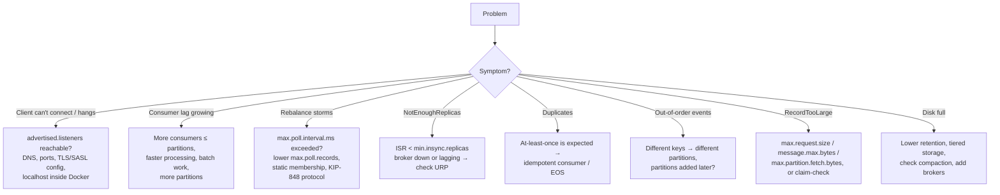

# 07 · Kafka Cheatsheet 📎

[← Operations & Security](06-operations-security.md) · [Back to Index](README.md)

> In the `apache/kafka` image the scripts are in `/opt/kafka/bin/`. `BS=--bootstrap-server localhost:9092`

## 🗂️ Topics

```bash
kafka-topics.sh $BS --list
kafka-topics.sh $BS --create --topic orders --partitions 6 --replication-factor 3 \
  --config min.insync.replicas=2 --config retention.ms=604800000
kafka-topics.sh $BS --describe --topic orders          # leaders, replicas, ISR
kafka-topics.sh $BS --describe --under-replicated-partitions
kafka-topics.sh $BS --alter --topic orders --partitions 12   # ⚠️ only increases, remaps keys
kafka-topics.sh $BS --delete --topic orders

kafka-configs.sh $BS --entity-type topics --entity-name orders \
  --alter --add-config retention.ms=86400000,cleanup.policy=compact
kafka-configs.sh $BS --entity-type topics --entity-name orders --describe
```

## ✍️ Produce & 👀 Consume

```bash
# produce with keys (key:value)
kafka-console-producer.sh $BS --topic orders \
  --property parse.key=true --property key.separator=:
> order-42:{"status":"PAID"}

# consume from the beginning, show keys, partitions, offsets
kafka-console-consumer.sh $BS --topic orders --from-beginning \
  --property print.key=true --property print.partition=true --property print.offset=true

kafka-console-consumer.sh $BS --topic orders --group debug-cli   # as a group
kafka-console-consumer.sh $BS --topic orders --partition 1 --offset 100 --max-messages 10
```

> 🧰 **kcat** (formerly kafkacat) is a handy Swiss-army knife:
> `kcat -b localhost:9092 -t orders -C -o beginning -f '%p %o %k: %s\n'`

## 👥 Consumer Groups

```bash
kafka-consumer-groups.sh $BS --list
kafka-consumer-groups.sh $BS --describe --group billing         # LAG per partition
kafka-consumer-groups.sh $BS --describe --group billing --members

# reset offsets (the group must be stopped). --dry-run first, then --execute
kafka-consumer-groups.sh $BS --group billing --topic orders --reset-offsets --to-earliest --dry-run
kafka-consumer-groups.sh $BS --group billing --topic orders --reset-offsets --to-datetime 2026-11-18T00:00:00.000 --execute
kafka-consumer-groups.sh $BS --group billing --topic orders:1 --reset-offsets --shift-by -100 --execute
```

## 🧠 Cluster / KRaft

```bash
kafka-metadata-quorum.sh $BS describe --status        # controller quorum health
kafka-metadata-quorum.sh $BS describe --replication
kafka-broker-api-versions.sh $BS
kafka-features.sh $BS describe                        # metadata.version, feature levels
kafka-log-dirs.sh $BS --describe --topic-list orders  # partition sizes on disk
kafka-storage.sh random-uuid                          # new cluster ID
kafka-storage.sh format -t <uuid> -c server.properties
```

## 🔐 ACLs & Quotas

```bash
kafka-acls.sh $BS --list
kafka-acls.sh $BS --add --allow-principal User:app --operation Write --topic orders
kafka-configs.sh $BS --entity-type users --entity-name app \
  --alter --add-config producer_byte_rate=10485760,consumer_byte_rate=20971520
```

## ⚡ Perf Testing

```bash
kafka-producer-perf-test.sh --topic perf --num-records 1000000 --record-size 1000 \
  --throughput -1 --producer-props bootstrap.servers=localhost:9092 acks=all compression.type=lz4
kafka-consumer-perf-test.sh $BS --topic perf --messages 1000000
```

## 🩻 Troubleshooting Flow



## 🔢 Ports

| Port | Use (convention) |
|------|------------------|
| 9092 | Client listener (PLAINTEXT / SASL) |
| 9093 | KRaft controller listener |
| 9094+ | Extra / external listeners |
| 8083 | Kafka Connect REST |
| 8081 | Schema Registry |

## 📋 Golden Rules

```
 1. RF=3, min.insync.replicas=2, acks=all, idempotence on
 2. Choose keys for ordering AND even distribution; size partitions up front
 3. One long-lived producer per app; always handle send callbacks
 4. Commit offsets AFTER processing; consumers must be idempotent
 5. Keep processing between polls short → avoid rebalance storms
 6. Retry topics + DLT for poison records
 7. Schemas with a registry + compatibility rules
 8. Outbox + CDC instead of dual writes
 9. TLS + SASL + ACLs, auto.create.topics.enable=false, topics as code
10. Alert on URP, under-min-ISR, offline partitions, consumer lag
```

## 🧾 Config Quick Reference

| Scope | Key | Recommended |
|-------|-----|-------------|
| Producer | `acks` | `all` |
| Producer | `enable.idempotence` | `true` |
| Producer | `compression.type` | `zstd` / `lz4` |
| Producer | `linger.ms` / `batch.size` | `10` / `131072` |
| Consumer | `enable.auto.commit` | `false` (manual) |
| Consumer | `auto.offset.reset` | `earliest` for new pipelines |
| Consumer | `group.protocol` | `consumer` (KIP-848) |
| Consumer | `isolation.level` | `read_committed` with transactions |
| Topic | `replication.factor` / `min.insync.replicas` | `3` / `2` |
| Topic | `cleanup.policy` | `delete` (events) / `compact` (state) |
| Broker | `auto.create.topics.enable` | `false` |
| Broker | `unclean.leader.election.enable` | `false` |
