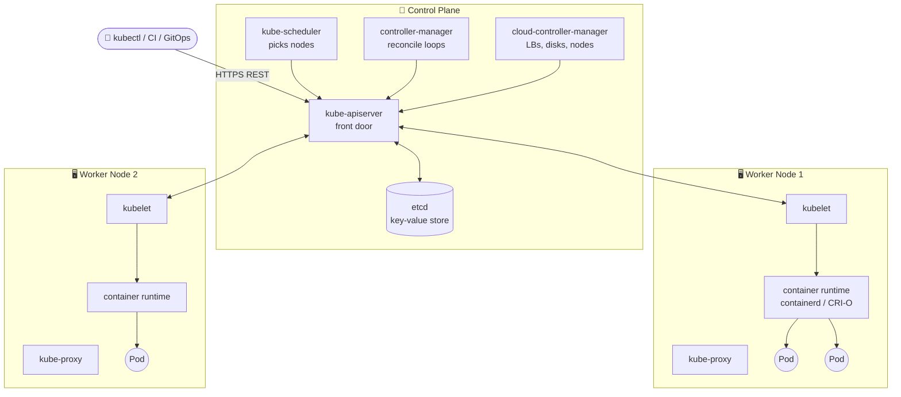
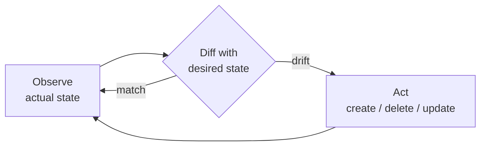
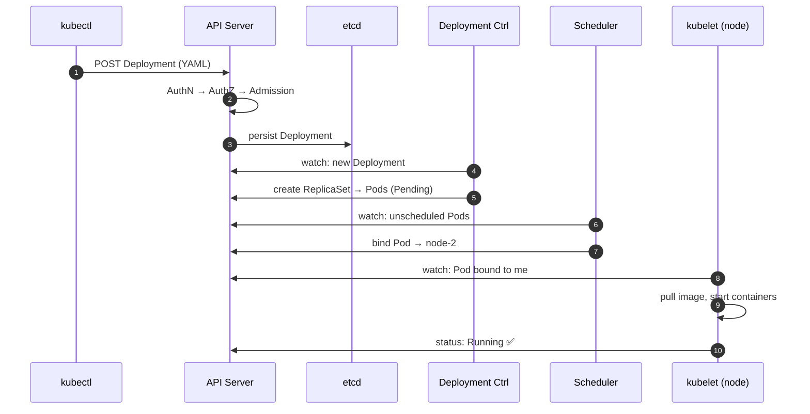

# 01 · Foundations & Architecture 🟢

[← Index](README.md) · [Next: Core Workloads →](02-core-workloads.md)

## Why Kubernetes?

Containers package an app. **Kubernetes (K8s)** runs many containers across many machines and keeps them healthy.

```
  Without an orchestrator               With Kubernetes
  ─────────────────────────             ─────────────────────────────
  ssh server1 && docker run ...         kubectl apply -f app.yaml
  ssh server2 && docker run ...           ✔ placement (scheduling)
  app crashed at 3am? → you wake up       ✔ self-healing restarts
  traffic spike? → manual scale           ✔ autoscaling
  new version? → pray                     ✔ rolling updates & rollback
                                          ✔ service discovery & load balancing
```

## 🏛️ Cluster Architecture



### Control plane components

| Component | Role | Analogy |
|-----------|------|---------|
| **kube-apiserver** | The only component that talks to etcd. Validates and stores every object | Reception desk |
| **etcd** | Distributed, consistent key-value store holding the cluster state | The ledger |
| **kube-scheduler** | Assigns unscheduled Pods to a node based on resources and constraints | Seating host |
| **kube-controller-manager** | Runs controllers (Deployment, ReplicaSet, Node, Job...) | Managers on patrol |
| **cloud-controller-manager** | Integrates with the cloud (LoadBalancers, volumes, node lifecycle) | Cloud liaison |

### Node components

| Component | Role |
|-----------|------|
| **kubelet** | Agent on each node. Makes sure the Pods assigned to it are running |
| **Container runtime** | Pulls images and runs containers (containerd, CRI-O) through the **CRI** |
| **kube-proxy** | Programs iptables/IPVS rules for Services (some CNIs such as Cilium replace it with eBPF) |
| **CNI plugin** | Gives Pods IPs and connects them (Calico, Cilium, Flannel) |

## 🔁 The Reconciliation Loop

Every controller runs the same loop:



**Example:** you ask for `replicas: 3`. A node dies and takes one Pod with it. The ReplicaSet controller sees 2 ≠ 3 and creates a new Pod. Nobody gets paged.

## 🚶 What Happens on `kubectl apply`?



> 💡 Components never talk directly to each other. They all **watch the API server**. This loose coupling is what makes Kubernetes extensible.

## 📄 Anatomy of a Kubernetes Object

```yaml
apiVersion: apps/v1          # API group + version
kind: Deployment             # object type
metadata:                    # identity
  name: web
  namespace: shop
  labels: { app: web, tier: frontend }
spec:                        # ✍️ DESIRED state (you write this)
  replicas: 3
  ...
status:                      # 👀 ACTUAL state (K8s writes this)
  readyReplicas: 3
```

## 🏷️ Namespaces, Labels & Selectors

```
Cluster
├── namespace: kube-system   (K8s internals)
├── namespace: default
├── namespace: shop-dev
│     ├── Deployment web   labels: app=web, env=dev
│     └── Deployment api   labels: app=api, env=dev
└── namespace: shop-prod
      ├── Deployment web   labels: app=web, env=prod
      └── Deployment api   labels: app=api, env=prod
```

- **Namespaces** give names a scope and are where quotas and RBAC apply. They are *not* a hard security boundary by themselves.
- **Labels** are key/value tags. **Selectors** query them: `kubectl get pods -l app=web,env=prod`.
- **Annotations** hold non-identifying metadata (build info, tool config).

## ✅ Key Takeaways

- K8s = **declarative desired state** + **controllers that reconcile**.
- The **API server** is the hub, and **etcd** is the source of truth.
- The **scheduler** decides *where*, and the **kubelet** makes it *happen*.
- Everything is an object with `apiVersion`, `kind`, `metadata`, `spec`, `status`.
