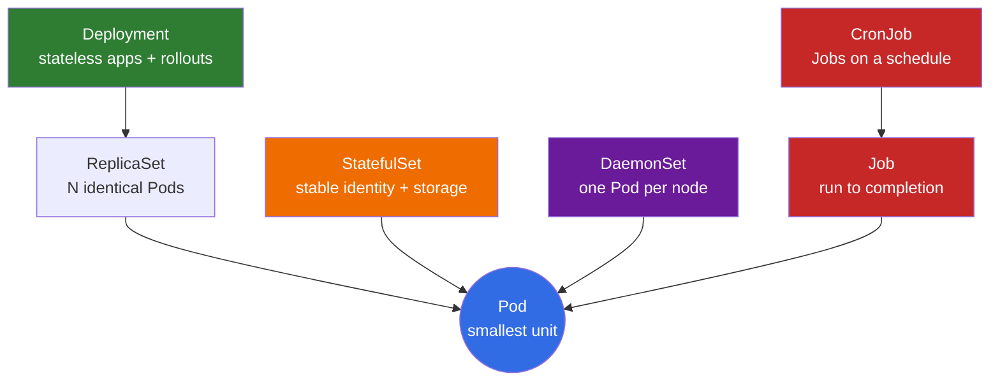
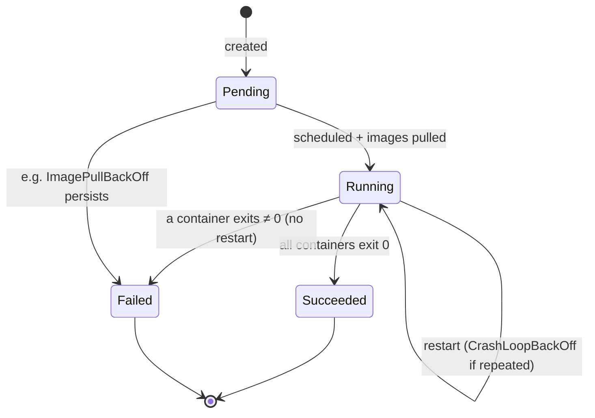
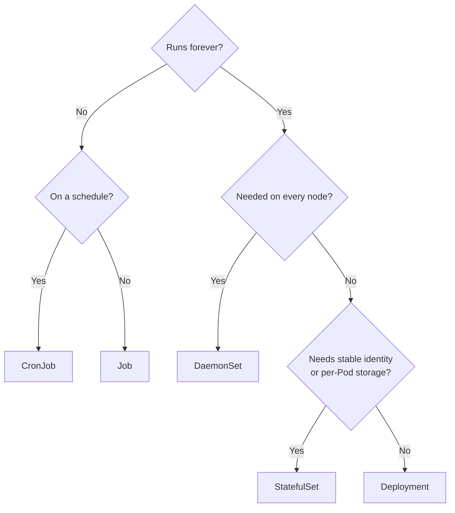

# 02 · Core Workloads 🟢

[← Foundations](01-foundations.md) · [Next: Networking →](03-networking.md)

## 🧩 The Workload Family Tree



> 💡 You rarely create bare Pods. You create a **controller** that manages Pods for you.

## 🫛 Pods

A Pod is **one or more containers** that share a network namespace (same IP, `localhost`) and volumes.

```
┌───────────────────── Pod  (IP 10.244.1.7) ─────────────────────┐
│                                                                 │
│  ┌──────────────┐   ┌──────────────┐   ┌──────────────────┐   │
│  │ init: migrate│ → │  app :8080   │ ↔ │ sidecar: log-ship│   │
│  │ (runs first, │   │ (main)       │   │ (helper)         │   │
│  │  then exits) │   └──────┬───────┘   └────────┬─────────┘   │
│  └──────────────┘          │    shared volume   │             │
│                            └────── /var/log ────┘             │
└─────────────────────────────────────────────────────────────────┘
```

| Pattern | Purpose | Example |
|---------|---------|---------|
| **Init container** | Setup before the app starts | DB migrations, wait-for-dependency |
| **Sidecar** | Runs alongside the app for its whole life | Log shipper, proxy (native sidecars use `restartPolicy: Always` on an init container) |
| **Ambassador / Adapter** | Proxy or reformat traffic or metrics | Local DB proxy, metrics exporter |

### Pod lifecycle



## 🚀 Deployments (Stateless Apps)

```
Deployment "web" (replicas: 3, image: v2)
   │
   ├── ReplicaSet web-7d9f (v2)  ──▶ 🟢 🟢 🟢     ← current
   └── ReplicaSet web-5b1c (v1)  ──▶ (scaled to 0) ← kept for rollback
```

```yaml
apiVersion: apps/v1
kind: Deployment
metadata:
  name: web
spec:
  replicas: 3
  selector:
    matchLabels: { app: web }
  strategy:
    type: RollingUpdate
    rollingUpdate: { maxSurge: 1, maxUnavailable: 0 }
  template:                       # ← the Pod template
    metadata:
      labels: { app: web }
    spec:
      containers:
        - name: web
          image: nginx:1.27
          ports: [{ containerPort: 80 }]
```

### Rolling update, step by step

```
maxSurge: 1, maxUnavailable: 0

t0  v1 🟢🟢🟢
t1  v1 🟢🟢🟢   v2 🟡            (surge: start new pod)
t2  v1 🟢🟢     v2 🟢            (new ready → kill one old)
t3  v1 🟢       v2 🟢🟢🟡
t4              v2 🟢🟢🟢        ✅ done, zero downtime
```

```bash
kubectl set image deploy/web web=nginx:1.28
kubectl rollout status deploy/web
kubectl rollout history deploy/web
kubectl rollout undo deploy/web            # ⏪ rollback
```

| Strategy | Behavior | When |
|----------|----------|------|
| `RollingUpdate` (default) | Gradual replacement | Most apps |
| `Recreate` | Kill all, then start new | App can't run two versions at once |
| Blue/Green, Canary | Done with Services, Ingress, Argo Rollouts or a mesh | Risky releases (see ch. 07) |

## 🗄️ StatefulSets (Stateful Apps)

For databases, queues and clustered systems that need **stable identity**.

```
StatefulSet "db" (replicas: 3) + headless Service "db"

  db-0 ──▶ PVC data-db-0 ──▶ 💾     DNS: db-0.db.ns.svc.cluster.local
  db-1 ──▶ PVC data-db-1 ──▶ 💾     DNS: db-1.db.ns.svc.cluster.local
  db-2 ──▶ PVC data-db-2 ──▶ 💾     DNS: db-2.db.ns.svc.cluster.local

  ✔ ordered start (0 → 1 → 2) and reverse-order stop
  ✔ a Pod keeps its name and its disk when rescheduled
```

| | Deployment | StatefulSet |
|--|-----------|-------------|
| Pod names | random (`web-7d9f-x2k`) | ordinal (`db-0`) |
| Storage | shared or none | one PVC per Pod (`volumeClaimTemplates`) |
| Ordering | parallel | ordered |
| Use for | APIs, web, workers | Postgres, Kafka, Elasticsearch |

## 👹 DaemonSets

One Pod on **every** node (or on a subset selected with nodeSelector or tolerations).

```
node-1: [fluent-bit] [node-exporter]
node-2: [fluent-bit] [node-exporter]
node-3: [fluent-bit] [node-exporter]   ← new node? pods appear automatically
```

Use for log collectors, monitoring agents, CNI/CSI drivers and security agents.

## ⏱️ Jobs & CronJobs

```yaml
apiVersion: batch/v1
kind: CronJob
metadata:
  name: nightly-report
spec:
  schedule: "0 2 * * *"            # 02:00 every day
  concurrencyPolicy: Forbid
  jobTemplate:
    spec:
      backoffLimit: 3               # retries
      completions: 1
      parallelism: 1
      ttlSecondsAfterFinished: 3600 # auto-cleanup
      template:
        spec:
          restartPolicy: OnFailure
          containers:
            - name: report
              image: myorg/report:1.4
```

```
CronJob ──(02:00)──▶ Job ──▶ Pod ──▶ ✅ Completed
                         └─▶ Pod ──▶ ❌ → retry (backoffLimit)
```

## 🧭 Which Workload Should I Use?



## ✅ Key Takeaways

- **Pod** = co-located containers sharing an IP and volumes. Treat Pods as disposable.
- **Deployment → ReplicaSet → Pods** gives you rolling updates and rollback.
- **StatefulSet** gives stable names, ordering and per-Pod volumes.
- **DaemonSet** runs per node. **Job/CronJob** run to completion.
