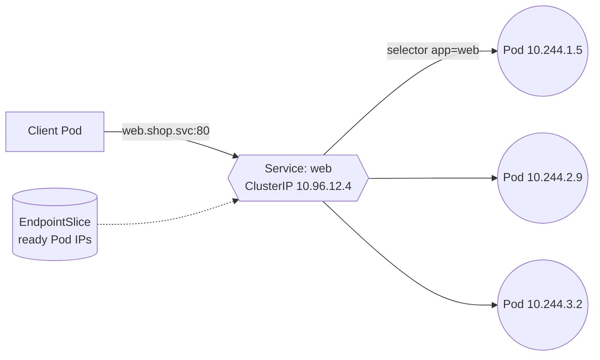
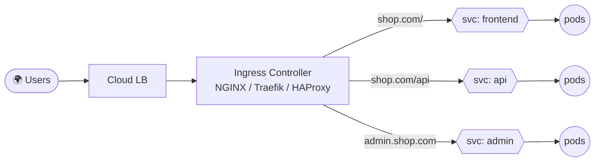

# 03 · Networking 🟡

[← Core Workloads](02-core-workloads.md) · [Next: Config & Storage →](04-config-storage.md)

## 🌐 The Kubernetes Network Model

Three rules that every CNI plugin implements:

1. Every Pod gets its **own IP**.
2. Pods can reach **all other Pods** without NAT, across nodes.
3. Agents on a node (such as the kubelet) can reach all Pods on that node.

```
          node-1 (192.168.0.11)                 node-2 (192.168.0.12)
   ┌──────────────────────────────┐      ┌──────────────────────────────┐
   │  Pod A 10.244.1.5            │      │  Pod C 10.244.2.9            │
   │  Pod B 10.244.1.6            │      │                              │
   │        │  cni0 bridge        │      │        │                     │
   └────────┼─────────────────────┘      └────────┼─────────────────────┘
            └──────── overlay / routed (CNI: Calico, Cilium, Flannel) ───┘
                     Pod A ──▶ 10.244.2.9 works directly ✅
```

Pod IPs change whenever Pods are recreated. **Services** solve that.

## 🔌 Services: Stable Virtual IPs



```yaml
apiVersion: v1
kind: Service
metadata:
  name: web
spec:
  type: ClusterIP           # default
  selector: { app: web }    # ← matches Pod labels
  ports:
    - port: 80              # Service port
      targetPort: 8080      # container port
```

### Service types

```
┌─────────────────────────────────────────────────────────────────┐
│ LoadBalancer   ☁️ cloud LB (public IP)                           │
│  ┌──────────────────────────────────────────────────────────┐   │
│  │ NodePort      <every-node-IP>:30000-32767                │   │
│  │  ┌───────────────────────────────────────────────────┐   │   │
│  │  │ ClusterIP    internal virtual IP (default)        │   │   │
│  │  └───────────────────────────────────────────────────┘   │   │
│  └──────────────────────────────────────────────────────────┘   │
└─────────────────────────────────────────────────────────────────┘
   Each type builds on the one inside it.
```

| Type | Reachable from | Use |
|------|---------------|-----|
| `ClusterIP` | Inside the cluster | Service-to-service traffic |
| `NodePort` | `nodeIP:port` | Dev, bare metal, behind an external LB |
| `LoadBalancer` | Internet or VPC | Exposing one service directly |
| `ExternalName` | n/a (a DNS CNAME) | Aliasing an external host |
| Headless (`clusterIP: None`) | DNS returns Pod IPs | StatefulSets, client-side load balancing |

## 📛 DNS (CoreDNS)

```
<service>.<namespace>.svc.cluster.local

web                              → same namespace
web.shop                         → other namespace
web.shop.svc.cluster.local       → fully qualified
db-0.db.shop.svc.cluster.local   → a specific StatefulSet Pod (headless)
```

## 🚪 Ingress: HTTP Routing into the Cluster



```yaml
apiVersion: networking.k8s.io/v1
kind: Ingress
metadata:
  name: shop
  annotations:
    cert-manager.io/cluster-issuer: letsencrypt   # automatic TLS
spec:
  ingressClassName: nginx
  tls:
    - hosts: [shop.com]
      secretName: shop-tls
  rules:
    - host: shop.com
      http:
        paths:
          - path: /api
            pathType: Prefix
            backend: { service: { name: api, port: { number: 80 } } }
          - path: /
            pathType: Prefix
            backend: { service: { name: frontend, port: { number: 80 } } }
```

> ⚠️ An Ingress object does nothing on its own. You must install an **Ingress controller**.

## 🛣️ Gateway API: The Successor to Ingress

It is role-oriented, more expressive, and supports HTTP, gRPC, TCP and TLS.

```
 Infra provider      Cluster operator          App developer
 ──────────────      ────────────────          ─────────────
 GatewayClass   ──▶  Gateway (listeners,  ◀──  HTTPRoute (hosts, paths,
 (which impl)        ports, TLS)               header match, traffic split)
```

```yaml
apiVersion: gateway.networking.k8s.io/v1
kind: HTTPRoute
metadata: { name: api }
spec:
  parentRefs: [{ name: public-gw }]
  hostnames: [api.shop.com]
  rules:
    - backendRefs:
        - { name: api-v1, port: 80, weight: 90 }   # 🐤 canary
        - { name: api-v2, port: 80, weight: 10 }
```

## 🧱 NetworkPolicies: Pod Firewalls

By default **all Pods can talk to all Pods**. NetworkPolicies restrict that (your CNI must support them).

```
              ┌──────────┐      ┌──────────┐      ┌──────────┐
  Internet ──▶│ frontend │ ───▶ │   api    │ ───▶ │    db    │
              └──────────┘      └──────────┘      └──────────┘
                    ╳──────────────────────────────────▶
                    frontend → db  BLOCKED by policy 🚫
```

```yaml
# 1) Default deny all ingress in the namespace
apiVersion: networking.k8s.io/v1
kind: NetworkPolicy
metadata: { name: default-deny }
spec:
  podSelector: {}
  policyTypes: [Ingress]
---
# 2) Allow only api → db on 5432
apiVersion: networking.k8s.io/v1
kind: NetworkPolicy
metadata: { name: db-allow-api }
spec:
  podSelector: { matchLabels: { app: db } }
  ingress:
    - from:
        - podSelector: { matchLabels: { app: api } }
      ports: [{ port: 5432 }]
```

## ✅ Key Takeaways

- Pods have ephemeral IPs. **Services** give a stable VIP and DNS name.
- `ClusterIP` ⊂ `NodePort` ⊂ `LoadBalancer`.
- **Ingress** or the **Gateway API** does L7 routing and TLS. Both need a controller.
- **NetworkPolicies** are allow-lists. Start with default deny.
