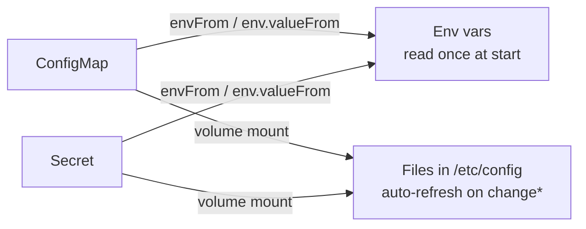
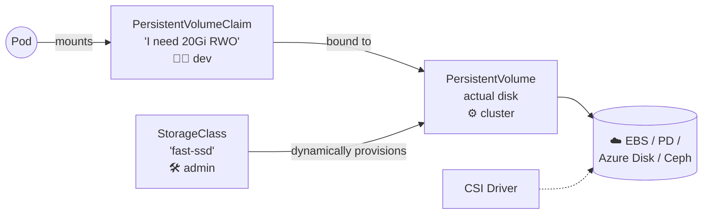

# 04 · Configuration & Storage 🟡

[← Networking](03-networking.md) · [Next: Scheduling & Scaling →](05-scheduling-scaling.md)

## ⚙️ Separate Config from Code

```
   Same image everywhere                 Different config per environment
   ┌──────────────┐                      ┌───────────┐ ┌───────────┐ ┌───────────┐
   │ myapp:1.4.2  │ ──── deployed to ──▶ │ dev       │ │ staging   │ │ prod      │
   └──────────────┘                      │ ConfigMap │ │ ConfigMap │ │ ConfigMap │
                                         │ Secret    │ │ Secret    │ │ Secret    │
                                         └───────────┘ └───────────┘ └───────────┘
```

## 📝 ConfigMaps & 🔐 Secrets

```yaml
apiVersion: v1
kind: ConfigMap
metadata: { name: app-config }
data:
  LOG_LEVEL: info
  FEATURE_FLAGS: "search,checkout-v2"
  app.yaml: |
    cache:
      ttl: 300
---
apiVersion: v1
kind: Secret
metadata: { name: app-secrets }
type: Opaque
stringData:                 # plain text in, stored base64-encoded
  DB_PASSWORD: s3cr3t
```

### Two ways to consume them



```yaml
spec:
  containers:
    - name: app
      envFrom:
        - configMapRef: { name: app-config }
        - secretRef:    { name: app-secrets }
      volumeMounts:
        - { name: cfg, mountPath: /etc/config, readOnly: true }
  volumes:
    - name: cfg
      configMap: { name: app-config }
```

\* Mounted files update eventually (not when mounted with `subPath`). Env vars never update, so restart the Pod or use a checksum annotation to roll it.

> ⚠️ **Secrets are base64-encoded, not encrypted.** For real protection:
> - enable **encryption at rest** for etcd (KMS provider)
> - restrict access with **RBAC**
> - keep the source of truth outside the cluster: **External Secrets Operator**, **Sealed Secrets**, **Vault**, **SOPS**

## 💾 Storage

### Volume types at a glance

| Type | Lifetime | Use |
|------|----------|-----|
| `emptyDir` | Dies with the Pod | Scratch space, sharing between containers |
| `configMap` / `secret` / `projected` | Pod | Injecting config |
| `hostPath` | Node | ⚠️ Avoid (security risk); system agents only |
| **PersistentVolumeClaim** | Independent of the Pod | Databases, uploads, anything durable |

### The PV / PVC / StorageClass model



```
  Analogy 🍽️
  StorageClass = the menu        ("SSD, replicated, retain")
  PVC          = your order      ("20Gi of SSD please")
  PV           = the dish served (a real 20Gi volume)
```

```yaml
apiVersion: storage.k8s.io/v1
kind: StorageClass
metadata: { name: fast-ssd }
provisioner: ebs.csi.aws.com
parameters: { type: gp3 }
reclaimPolicy: Retain              # keep the disk when the PVC is deleted
volumeBindingMode: WaitForFirstConsumer   # provision in the Pod's zone
allowVolumeExpansion: true
---
apiVersion: v1
kind: PersistentVolumeClaim
metadata: { name: uploads }
spec:
  accessModes: [ReadWriteOnce]
  storageClassName: fast-ssd
  resources:
    requests: { storage: 20Gi }
```

### Access modes

| Mode | Short | Meaning |
|------|-------|---------|
| ReadWriteOnce | RWO | Read-write by **one node** (block disks) |
| ReadWriteOncePod | RWOP | Read-write by **one Pod** |
| ReadOnlyMany | ROX | Read-only by many nodes |
| ReadWriteMany | RWX | Read-write by many nodes (NFS, EFS, CephFS) |

### PVC lifecycle

```
  Pending ──(PV provisioned & bound)──▶ Bound ──(PVC deleted)──▶ Released
                                                                   │
                                     reclaimPolicy: Delete → disk removed 🗑️
                                     reclaimPolicy: Retain → disk kept 💾
```

> 💡 **VolumeSnapshots** (CSI) let you back up and clone PVCs. Use **Velero** for whole-cluster backup and restore.

## ✅ Key Takeaways

- **ConfigMap** holds non-sensitive config. **Secret** holds sensitive data (encode ≠ encrypt).
- Consume them as **env vars** (static) or **mounted files** (they refresh).
- **PVC** = request, **PV** = the actual volume, **StorageClass** = how to make volumes on demand.
- Use `WaitForFirstConsumer` and `Retain` for production data.
