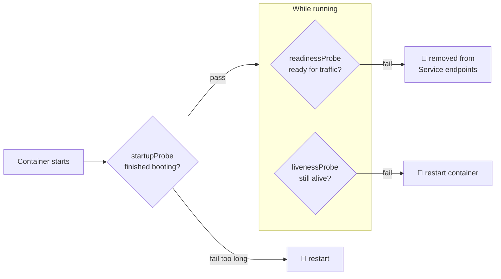
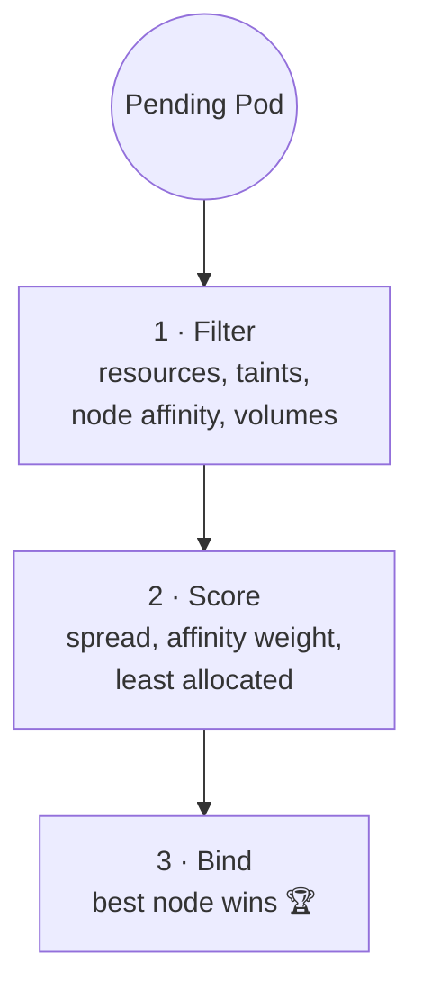
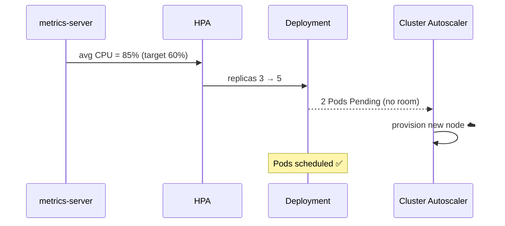

# 05 · Scheduling, Health & Scaling 🟡

[← Config & Storage](04-config-storage.md) · [Next: Security →](06-security.md)

## 📏 Requests & Limits

```
             CPU / Memory for one container
  0 ─────────────[ request ]──────────────[ limit ]──────────▶
                     │                        │
     guaranteed & used for scheduling     hard ceiling
                                          CPU  → throttled 🐢
                                          RAM  → OOMKilled 💀
```

```yaml
resources:
  requests: { cpu: 250m, memory: 256Mi }   # 250m = 0.25 core
  limits:   { memory: 512Mi }              # common practice: memory limit, no CPU limit
```

### QoS classes (who gets evicted first under memory pressure)

| QoS | Rule | Eviction order |
|-----|------|----------------|
| **Guaranteed** | requests == limits for CPU and memory in every container | Last 🛡️ |
| **Burstable** | Some requests set, not equal to limits | Middle |
| **BestEffort** | Nothing set | First 🔥 |

> Set defaults per namespace with **LimitRange** and cap totals with **ResourceQuota**.

## 🩺 Health Probes



| Probe | Question | On failure |
|-------|----------|------------|
| `startupProbe` | Has the app finished starting? | Restart (holds off the other probes until it passes) |
| `readinessProbe` | Can it serve traffic now? | Removed from load balancing, **not** restarted |
| `livenessProbe` | Is it deadlocked or broken? | Container restarted |

```yaml
startupProbe:
  httpGet: { path: /healthz, port: 8080 }
  failureThreshold: 30
  periodSeconds: 2          # up to 60s to boot
readinessProbe:
  httpGet: { path: /ready, port: 8080 }
  periodSeconds: 5
livenessProbe:
  httpGet: { path: /healthz, port: 8080 }
  periodSeconds: 10
  failureThreshold: 3
```

> ⚠️ Don't make liveness depend on downstream services such as the DB. One DB outage would then restart every Pod.

## 🎯 Controlling Placement



| Tool | Says | Example |
|------|------|---------|
| `nodeSelector` | "Only nodes with this label" | `disktype: ssd` |
| **Node affinity** | Required or preferred node rules | "prefer zone eu-west-1a" |
| **Pod affinity** | "Near Pods like X" | Cache next to the app |
| **Pod anti-affinity** | "Away from Pods like X" | Replicas on different nodes |
| **Taints & tolerations** | Node: "keep out unless you tolerate me" | GPU nodes, dedicated nodes |
| **Topology spread** | "Spread evenly across zones or nodes" | HA across AZs |

### Taints & tolerations

```
  node-gpu  🏷️ taint: gpu=true:NoSchedule
     ▲
     │   ❌ regular pod      (no toleration) → bounced
     │   ✅ ml-training pod  (tolerates gpu=true) → allowed
```

```yaml
tolerations:
  - { key: gpu, operator: Equal, value: "true", effect: NoSchedule }
topologySpreadConstraints:
  - maxSkew: 1
    topologyKey: topology.kubernetes.io/zone
    whenUnsatisfiable: DoNotSchedule
    labelSelector: { matchLabels: { app: web } }
```

## 📈 Autoscaling: Three Dimensions

```
                    ┌───────────────────────────────────────────┐
  More Pods  ◀──────│ HPA   Horizontal Pod Autoscaler           │
                    │       CPU / memory / custom metrics       │
                    ├───────────────────────────────────────────┤
  Bigger Pods ◀─────│ VPA   Vertical Pod Autoscaler             │
                    │       right-sizes requests                │
                    ├───────────────────────────────────────────┤
  More Nodes ◀──────│ Cluster Autoscaler / Karpenter            │
                    │       adds nodes when Pods are Pending    │
                    ├───────────────────────────────────────────┤
  Event-driven ◀────│ KEDA  queue length, Kafka lag, cron,      │
                    │       scale to zero                       │
                    └───────────────────────────────────────────┘
```



```yaml
apiVersion: autoscaling/v2
kind: HorizontalPodAutoscaler
metadata: { name: web }
spec:
  scaleTargetRef: { apiVersion: apps/v1, kind: Deployment, name: web }
  minReplicas: 3
  maxReplicas: 20
  metrics:
    - type: Resource
      resource:
        name: cpu
        target: { type: Utilization, averageUtilization: 60 }
```

> HPA utilization is a percentage of **requests**, so requests must be set.

## 🛡️ Availability During Disruption

**PodDisruptionBudget** stops voluntary disruptions (node drains, upgrades) from taking down too many Pods at once.

```yaml
apiVersion: policy/v1
kind: PodDisruptionBudget
metadata: { name: web-pdb }
spec:
  minAvailable: 2
  selector: { matchLabels: { app: web } }
```

**PriorityClass** lets critical Pods preempt less important ones when the cluster is full.

## ✅ Key Takeaways

- **Requests** drive scheduling and **limits** cap usage. Always set memory.
- **Readiness** gates traffic, **liveness** restarts, **startup** protects slow boots.
- Use anti-affinity and topology spread for HA, and taints for dedicated nodes.
- Scale Pods with **HPA/KEDA**, size them with **VPA**, and add nodes with **CA/Karpenter**. Protect them with a **PDB**.
