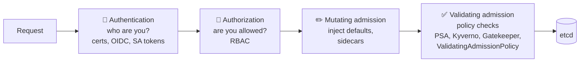
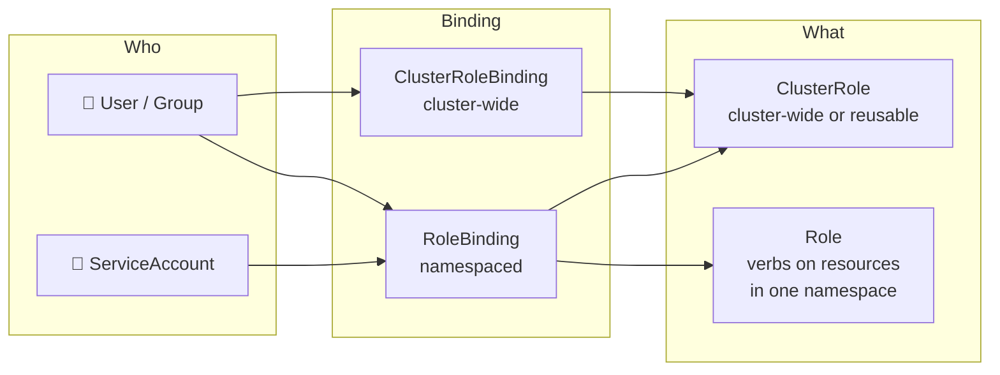
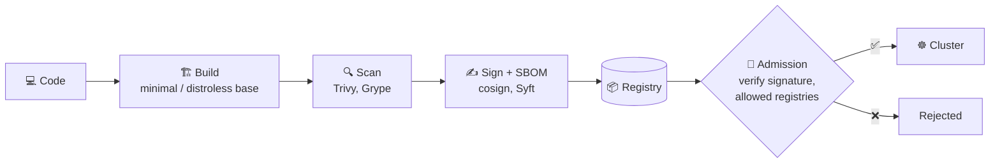

# 06 · Security 🔴

[← Scheduling & Scaling](05-scheduling-scaling.md) · [Next: Advanced Patterns →](07-advanced.md)

## 🧅 Defense in Depth: The 4C Model

```
┌───────────────────────────────────────────────────────────┐
│ ☁️  Cloud / Data center   IAM, network, encrypted disks    │
│  ┌─────────────────────────────────────────────────────┐  │
│  │ ☸️  Cluster   RBAC, admission, NetworkPolicy, audit  │  │
│  │  ┌───────────────────────────────────────────────┐  │  │
│  │  │ 📦 Container  non-root, read-only FS, scanned │  │  │
│  │  │  ┌─────────────────────────────────────────┐  │  │  │
│  │  │  │ 💻 Code  deps, secrets, input handling  │  │  │  │
│  │  │  └─────────────────────────────────────────┘  │  │  │
│  │  └───────────────────────────────────────────────┘  │  │
│  └─────────────────────────────────────────────────────┘  │
└───────────────────────────────────────────────────────────┘
```

## 🚦 The API Request Pipeline



## 👥 RBAC



```yaml
apiVersion: rbac.authorization.k8s.io/v1
kind: Role
metadata: { name: pod-reader, namespace: shop }
rules:
  - apiGroups: [""]
    resources: [pods, pods/log]
    verbs: [get, list, watch]
---
apiVersion: rbac.authorization.k8s.io/v1
kind: RoleBinding
metadata: { name: ci-reads-pods, namespace: shop }
subjects:
  - kind: ServiceAccount
    name: ci-bot
    namespace: shop
roleRef:
  kind: Role
  name: pod-reader
  apiGroup: rbac.authorization.k8s.io
```

```bash
kubectl auth can-i delete pods -n shop --as system:serviceaccount:shop:ci-bot
# no ✅
```

> 🔑 **Least privilege:** avoid `cluster-admin`, avoid `*` verbs, and treat `secrets`, `pods/exec`, `escalate`, `bind` and `impersonate` as sensitive.

## 🤖 ServiceAccounts (Workload Identity)

```
Pod ──uses──▶ ServiceAccount "api" ──RBAC──▶ K8s API permissions
                     │
                     └──(IRSA / Workload Identity)──▶ ☁️ cloud IAM role
                                                     (S3, GCS, KeyVault)
```

- Each namespace has a `default` SA. Create **dedicated SAs** per app.
- Set `automountServiceAccountToken: false` when the app doesn't call the API.
- Tokens are short-lived and projected (bound tokens).

## 🔒 Pod Security

### Pod Security Admission (built in)

| Level | Allows |
|-------|--------|
| `privileged` | Everything (system namespaces only) |
| `baseline` | Blocks known privilege escalations |
| `restricted` | Hardened best practice ✅ |

```bash
kubectl label ns shop pod-security.kubernetes.io/enforce=restricted
```

### A hardened container

```yaml
securityContext:              # pod level
  runAsNonRoot: true
  runAsUser: 10001
  fsGroup: 10001
  seccompProfile: { type: RuntimeDefault }
containers:
  - name: app
    image: myorg/app@sha256:ab12...     # pin by digest
    securityContext:
      allowPrivilegeEscalation: false
      readOnlyRootFilesystem: true
      capabilities: { drop: [ALL] }
```

## 📦 Supply Chain Security



## 🛠️ Policy & Runtime Tools

| Area | Tools |
|------|-------|
| Policy as code | **Kyverno**, **OPA Gatekeeper**, built-in **ValidatingAdmissionPolicy** (CEL) |
| Runtime threat detection | **Falco**, **Tetragon** |
| Posture and benchmarks | **kube-bench** (CIS), **Kubescape**, **Trivy operator** |
| Secrets | External Secrets, Vault, Sealed Secrets, SOPS |
| Audit | API server audit logs → SIEM |

## ✅ Security Checklist

- [ ] RBAC with least privilege, and no workloads running as `cluster-admin`
- [ ] Dedicated ServiceAccounts, token automount disabled when unused
- [ ] `restricted` Pod Security on app namespaces
- [ ] Non-root, read-only FS, all capabilities dropped
- [ ] Default-deny NetworkPolicies
- [ ] etcd encryption at rest and external secret management
- [ ] Images scanned, signed and pinned by digest
- [ ] Audit logging enabled and control plane kept up to date
