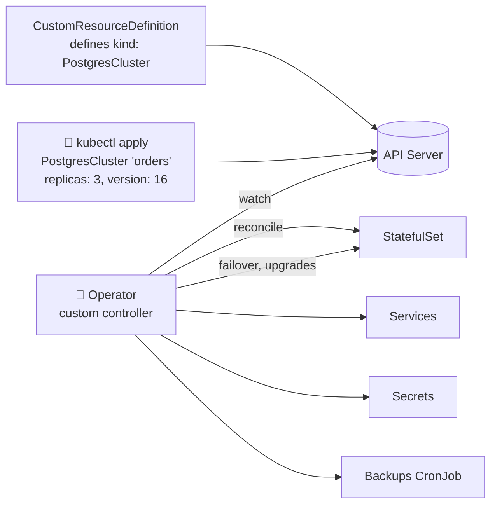
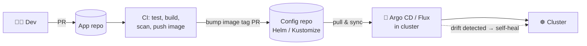
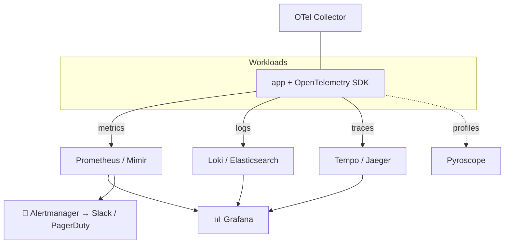
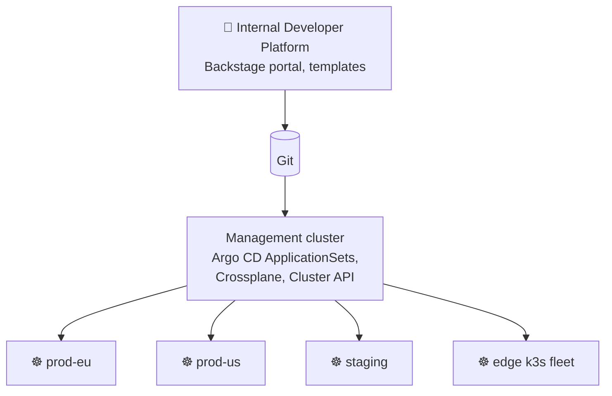

# 07 · Advanced Patterns 🔴

[← Security](06-security.md) · [Next: Cheatsheet →](08-cheatsheet.md)

## 🧬 Extending Kubernetes: CRDs + Operators

Kubernetes is a **platform for building platforms**. You can teach it new object types.



```yaml
apiVersion: postgresql.cnpg.io/v1
kind: Cluster                 # ← a custom resource
metadata: { name: orders-db }
spec:
  instances: 3
  storage: { size: 50Gi }
  backup:
    barmanObjectStore: { destinationPath: s3://backups/orders }
```

> An **Operator** = CRD + controller + operational knowledge (install, upgrade, backup, failover).
> Build one with **Kubebuilder** or **Operator SDK** (Go), or **kopf** (Python).

| Popular operators | Manages |
|-------------------|---------|
| CloudNativePG, Zalando | PostgreSQL |
| Strimzi | Kafka |
| cert-manager | TLS certificates |
| Prometheus Operator | Monitoring stack |
| Crossplane | Cloud resources as K8s objects |

## 📦 Packaging: Helm vs Kustomize

```
        HELM  (templating + releases)              KUSTOMIZE  (overlays, no templates)
  ┌───────────────────────────┐              ┌──────────────────────────┐
  │ chart/                    │              │ base/                    │
  │  ├── Chart.yaml           │              │  ├── deployment.yaml     │
  │  ├── values.yaml          │              │  └── kustomization.yaml  │
  │  └── templates/*.yaml     │              │ overlays/                │
  │        {{ .Values.x }}    │              │  ├── dev/  (patch: 1 rep)│
  └─────────────┬─────────────┘              │  └── prod/ (patch: 6 rep)│
                │ helm install -f prod.yaml  └────────────┬─────────────┘
                ▼                                         ▼ kubectl apply -k overlays/prod
           Release v3 (rollback-able)                plain YAML
```

| | Helm | Kustomize |
|--|------|-----------|
| Approach | Go templates + values | Patches over plain YAML |
| Distribution | Charts in OCI registries ✅ | Git directories |
| Best for | Third-party apps, configurable packages | Your own apps, env overlays |

> They combine well: Kustomize can render Helm charts, and Argo CD supports both.

## 🔄 GitOps

**Git is the source of truth.** An in-cluster agent pulls and reconciles.



| Push CD (classic) | GitOps (pull) |
|-------------------|---------------|
| CI holds cluster credentials | Credentials stay inside the cluster 🔐 |
| No drift detection | Continuous drift correction |
| Rollback = rerun the pipeline | Rollback = `git revert` |

## 🚢 Progressive Delivery

```
 Blue/Green                         Canary
 ──────────                         ──────
 [blue v1] ◀── 100% traffic         v1 ███████████████████  95%
 [green v2]    (tested idle)        v2 █                     5%  → watch metrics
      switch ⇄ instantly            v2 ████████            40%  → promote...
                                    v2 ████████████████████ 100% ✅  or auto-rollback ⏪
```

Tools: **Argo Rollouts**, **Flagger** (driven by Prometheus metrics, works with Ingress, Gateway API or a mesh).

## 🔭 Observability: The Three Pillars (+1)



| Pillar | Answers | K8s sources |
|--------|---------|-------------|
| **Metrics** | Is something wrong? | kube-state-metrics, node-exporter, cAdvisor |
| **Logs** | What happened? | Container stdout → Fluent Bit / Vector |
| **Traces** | Where is it slow? | OpenTelemetry auto-instrumentation |
| **Events** | What did K8s do? | `kubectl get events`, event exporter |

> Alert on **symptoms** (SLOs: latency, errors, saturation) rather than causes.

## 🕸️ Service Mesh

```
Without mesh                          With mesh (sidecar or ambient/eBPF)
────────────                          ──────────────────────────────────
[A] ───plain HTTP───▶ [B]             [A]─[proxy] ══mTLS══▶ [proxy]─[B]
 retries, TLS, metrics                       ▲                 ▲
 coded in every app                          └─ control plane ─┘
                                             (Istio, Linkerd, Cilium)
```

You get: **mTLS** everywhere, retries and timeouts, traffic splitting, golden metrics, and authorization policies, all without changing app code.
⚠️ The cost is added complexity and latency. Adopt a mesh when you need it.

## 🌍 Multi-Cluster & Platform Engineering



| Need | Tools |
|------|-------|
| Create and upgrade clusters declaratively | **Cluster API**, managed (EKS, GKE, AKS), Talos |
| Deploy to many clusters | Argo CD **ApplicationSets**, Flux, Fleet |
| Cloud infra from K8s | **Crossplane** |
| Cross-cluster networking | Cilium ClusterMesh, Istio multi-primary, Submariner |
| Multi-tenancy | Namespaces + RBAC + quotas, **vCluster**, Capsule |
| Cost visibility | **OpenCost**, Kubecost |

## 🤖 AI/ML Workloads on Kubernetes

```
GPU nodes (tainted) ── NVIDIA GPU Operator / device plugin ── nvidia.com/gpu: 1
     │
     ├── Training:  Kubeflow Training Operator, Ray (KubeRay), Volcano / Kueue (batch queues)
     └── Serving:   KServe, vLLM, Ray Serve  + HPA/KEDA on queue depth or tokens/sec
```

## 🧯 Day-2 Operations

| Task | Approach |
|------|----------|
| Cluster upgrades | Control plane first, then node pools one minor version at a time. Check deprecated APIs (`pluto`, `kubent`) |
| Backup and DR | etcd snapshots + **Velero** (resources + PV snapshots). Test restores |
| Debugging | `kubectl debug` ephemeral containers, `events`, `describe`, `top` |
| Capacity | Right-size requests (VPA recommendations, Goldilocks), Karpenter consolidation |

## ✅ Key Takeaways

- **CRDs + Operators** turn operational know-how into code.
- **Helm** packages apps and **Kustomize** patches environments. **GitOps** deploys both safely.
- Ship progressively (canary, blue/green) and observe with **OpenTelemetry + Prometheus + Grafana**.
- Add a **service mesh** or **multi-cluster** setup only when the problem demands it.
