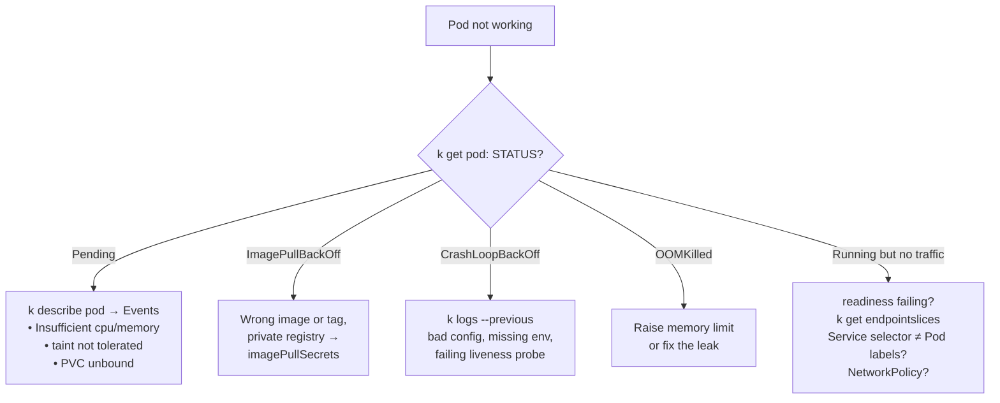

# 08 · kubectl Cheatsheet 📎

[← Advanced Patterns](07-advanced.md) · [Back to Index](README.md)

## 🧭 Command Shape

```
kubectl  <verb>   <resource>[/<name>]   [-n namespace]   [flags]
kubectl  get      pods                  -n shop          -o wide
kubectl  logs     deploy/web            -n shop          -f --tail=100
```

## ⚡ Setup & Context

```bash
alias k=kubectl
source <(kubectl completion bash)          # or zsh
kubectl config get-contexts
kubectl config use-context prod-eu
kubectl config set-context --current --namespace=shop
# tip: kubectx / kubens make switching fast
```

## 🔎 Inspect

```bash
k get pods -A                              # all namespaces
k get pods -o wide                         # node + IP
k get pods -l app=web --show-labels
k get deploy,svc,ing                       # several types at once
k get pod web-x -o yaml                    # full object
k get pods -o jsonpath='{.items[*].metadata.name}'
k describe pod web-x                       # events at the bottom 👀
k get events --sort-by=.lastTimestamp
k top pods / k top nodes                   # needs metrics-server
k explain deployment.spec.strategy         # built-in docs
k api-resources                            # every kind + short name
```

## ✍️ Create & Change

```bash
k apply -f app.yaml                        # declarative ✅
k apply -k overlays/prod                   # kustomize
k diff -f app.yaml                         # preview the change
k delete -f app.yaml

# generate YAML instead of writing it by hand
k create deploy web --image=nginx --replicas=3 --dry-run=client -o yaml > web.yaml
k create svc clusterip web --tcp=80:8080 --dry-run=client -o yaml
k create secret generic db --from-literal=PASSWORD=s3cr3t --dry-run=client -o yaml

k scale deploy/web --replicas=5
k set image deploy/web web=nginx:1.28
k edit deploy/web
k label pod web-x tier=frontend
k annotate deploy/web owner=team-a
```

## 🚀 Rollouts

```bash
k rollout status  deploy/web
k rollout history deploy/web
k rollout undo    deploy/web --to-revision=2
k rollout restart deploy/web               # re-roll Pods (e.g. after a config change)
```

## 🐛 Debug

```bash
k logs pod/web-x -c sidecar                # pick a container
k logs deploy/web -f --since=10m
k logs pod/web-x --previous                # logs from before the crash 💥
k exec -it pod/web-x -- sh
k debug -it pod/web-x --image=busybox --target=web   # ephemeral container
k debug node/node-1 -it --image=ubuntu
k port-forward svc/web 8080:80             # localhost:8080 → service
k run tmp --rm -it --image=curlimages/curl -- sh     # throwaway test pod
k auth can-i list secrets -n shop --as=jane
```

## 🩻 Troubleshooting Flow



## 📊 Status Cheat Codes

| Status | Usually means |
|--------|---------------|
| `Pending` | Can't be scheduled (resources, taints, volumes) |
| `ContainerCreating` | Pulling the image or mounting volumes |
| `ImagePullBackOff` / `ErrImagePull` | Bad image name, or registry auth |
| `CrashLoopBackOff` | The app keeps exiting, so check logs `--previous` |
| `OOMKilled` | Exceeded its memory limit |
| `CreateContainerConfigError` | Missing ConfigMap or Secret key |
| `Evicted` | Node pressure (disk or memory) |
| `Terminating` (stuck) | A finalizer is blocking deletion |

## 🧰 Handy Ecosystem Tools

| Tool | What it does |
|------|--------------|
| **k9s** | Terminal UI for clusters ⭐ |
| **kubectx / kubens** | Fast context and namespace switching |
| **stern** | Tail logs from many Pods at once |
| **krew** | kubectl plugin manager |
| **Lens / Headlamp** | Desktop or web GUI |
| **kubeconform** | Validate YAML against schemas in CI |
| **Popeye** | Lint a live cluster for misconfigurations |

## 📐 Short Names

```
po=pods  deploy=deployments  rs=replicasets  sts=statefulsets  ds=daemonsets
svc=services  ing=ingresses  cm=configmaps  ns=namespaces  no=nodes
pv=persistentvolumes  pvc=persistentvolumeclaims  sa=serviceaccounts
hpa=horizontalpodautoscalers  netpol=networkpolicies  crd=customresourcedefinitions
```
