# ☸️ Kubernetes: Foundations to Advanced

A short, illustrated guide to Kubernetes, from "what is a Pod?" to operators, GitOps and multi-cluster.
Each chapter is a summary: diagrams first, then the key ideas, then the YAML you actually write.

> Diagrams use **Mermaid** (rendered by GitHub, GitLab, Obsidian and VS Code) and plain ASCII art.

## 🗺️ Learning Path

```mermaid
flowchart LR
    A[01 Foundations<br/>Architecture] --> B[02 Workloads<br/>Pods & Controllers]
    B --> C[03 Networking<br/>Services & Ingress]
    C --> D[04 Config & Storage<br/>ConfigMaps · PVs]
    D --> E[05 Scheduling & Scaling<br/>Probes · HPA]
    E --> F[06 Security<br/>RBAC · Policies]
    F --> G[07 Advanced<br/>CRDs · GitOps · Mesh]
    G --> H[08 Cheatsheet<br/>kubectl]

    style A fill:#326ce5,color:#fff
    style B fill:#326ce5,color:#fff
    style C fill:#4a7fe8,color:#fff
    style D fill:#4a7fe8,color:#fff
    style E fill:#6b95ec,color:#fff
    style F fill:#6b95ec,color:#fff
    style G fill:#1e4fb5,color:#fff
    style H fill:#555,color:#fff
```



## 📚 Chapters

| # | Chapter | Level | You will learn |
|---|---------|-------|----------------|
| 01 | [Foundations & Architecture](01-foundations.md) | 🟢 Beginner | Why K8s exists, control plane vs nodes, the reconcile loop |
| 02 | [Core Workloads](02-core-workloads.md) | 🟢 Beginner | Pods, Deployments, StatefulSets, DaemonSets, Jobs |
| 03 | [Networking](03-networking.md) | 🟡 Intermediate | Services, DNS, Ingress, Gateway API, NetworkPolicies |
| 04 | [Configuration & Storage](04-config-storage.md) | 🟡 Intermediate | ConfigMaps, Secrets, Volumes, PV/PVC, StorageClasses |
| 05 | [Scheduling, Health & Scaling](05-scheduling-scaling.md) | 🟡 Intermediate | Requests/limits, probes, affinity, taints, HPA/VPA |
| 06 | [Security](06-security.md) | 🔴 Advanced | RBAC, ServiceAccounts, Pod Security, supply chain |
| 07 | [Advanced Patterns](07-advanced.md) | 🔴 Advanced | CRDs, Operators, Helm, GitOps, observability, service mesh |
| 08 | [kubectl Cheatsheet](08-cheatsheet.md) | 📎 Reference | The commands you will use every day |

## 🧠 The One Idea to Remember

```
   ┌──────────────┐        ┌──────────────┐        ┌──────────────┐
   │   You write  │        │  Kubernetes  │        │   Cluster    │
   │ DESIRED STATE│ ─────▶ │  CONTROLLERS │ ─────▶ │ ACTUAL STATE │
   │   (YAML)     │        │  (reconcile) │        │  (running)   │
   └──────────────┘        └──────┬───────┘        └──────┬───────┘
                                  ▲                       │
                                  └──── observe & diff ───┘
```

Kubernetes is a **declarative system**. You describe *what* you want, and controllers keep working to make reality match, forever.

## 🧪 Practice Locally

| Tool | Best for |
|------|----------|
| `kind` | Fast multi-node clusters inside Docker, good for CI |
| `minikube` | Beginner friendly, with addons (ingress, dashboard) |
| `k3d` / `k3s` | Lightweight, close to real edge/prod setups |
| Docker Desktop / OrbStack | One-click local cluster |

```bash
kind create cluster --name lab
kubectl get nodes
```
