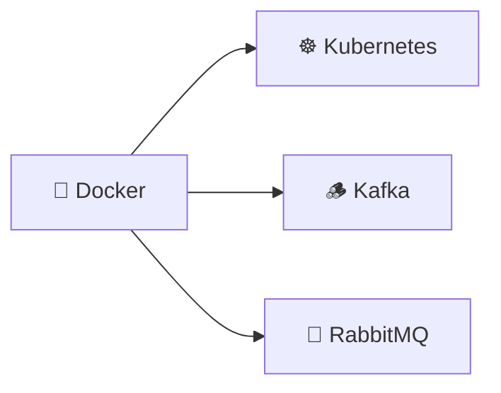

# 🎓 Practicals: Exams & Playbooks

Exams and hands-on playbooks for the four guides in this repo. Every question and lab is based on the guide chapters, and each answer links back to the chapter it comes from.

| Topic | 📝 Exam | 🛠️ Playbook | 📚 Guide |
|-------|---------|-------------|----------|
| 🐳 Docker | [exam](docker/exam.md) · 34 Qs · 90 min | [10 labs + 5 runbooks](docker/playbook.md) | [docker-foundations-to-advanced](../docker-foundations-to-advanced/README.md) |
| 🪵 Kafka | [exam](kafka/exam.md) · 34 Qs · 90 min | [10 labs + 5 runbooks](kafka/playbook.md) | [kafka-foundations-to-advanced](../kafka-foundations-to-advanced/README.md) |
| ☸️ Kubernetes | [exam](kubernetes/exam.md) · 34 Qs · 100 min | [10 labs + 5 runbooks](kubernetes/playbook.md) | [kubernetes-foundations-to-advanced](../kubernetes-foundations-to-advanced/README.md) |
| 🐰 RabbitMQ | [exam](rabbitmq/exam.md) · 34 Qs · 90 min | [10 labs + 5 runbooks](rabbitmq/playbook.md) + [lab kit](rabbitmq/lab/) | [rabbitmq-foundations-to-advanced](../rabbitmq-foundations-to-advanced/README.md) |

## 🗺️ Suggested Path

Do Docker first. Every other playbook runs its labs in containers.

For each topic:

1. 📖 Read the guide.
2. 🛠️ Do the playbook labs in order: 🟢 → 🟡 → 🔴.
3. 📝 Take the exam **without** opening the answers.
4. 🔁 Re-read the chapters linked from the answers you missed, then retake.

## 📝 Exam Format

Every exam has 100 points in four parts:

| Part | Format | Points |
|------|--------|--------|
| 🅰️ | 20 multiple choice | 40 |
| 🅱️ | 8 short answer | 24 |
| 🅲 | 3 fix-the-config / design tasks | 18 |
| 🅳 | 3 troubleshooting scenarios | 18 |

Answers are folded under **Answer** (`
`). **Pass mark: 70.** For Parts C and D, give partial credit when the key points are covered.

## 🛠️ Playbook Format

- **Part 1 · Labs**: Goal → Steps → ✅ Verify → 🧠 Explain → 🧹 Cleanup. Most labs include a deliberate **💥 break it / fix it** step.
- **Part 2 · Runbooks**: Symptom → Triage → Likely causes → Fix → Prevent, for the incidents you'll meet in production.

| Level | Meaning |
|-------|---------|
| 🟢 | Foundations: core concepts and daily commands |
| 🟡 | Intermediate: production features and common failures |
| 🔴 | Advanced: HA, security, internals |

## 🧰 Requirements

| Playbook | Needs |
|----------|-------|
| Docker | Docker Engine 25+ with Compose v2 (Linux host for the `nsenter` part of Lab 10) |
| Kafka | Docker + Compose, ~4 GB RAM (`apache/kafka:4.1.0`, 3 brokers + 1 controller) |
| Kubernetes | Docker, `kind` v0.24+, `kubectl` |
| RabbitMQ | Docker + Compose (`rabbitmq:4.1-management`, 3 nodes) |

> ⚠️ All credentials in the labs (`change-me`, lab cookies, passwords) are placeholders for local use only. Never reuse them.
