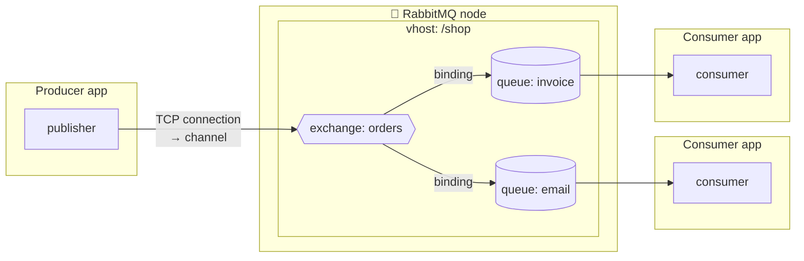
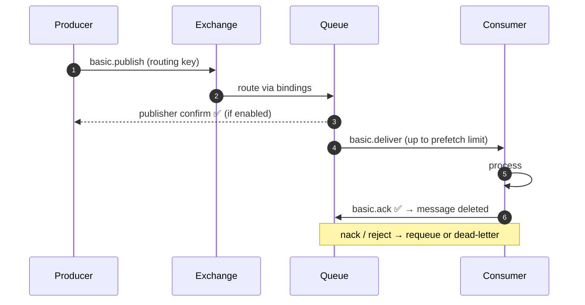

# 01 · Foundations 🟢

[← Index](README.md) · [Next: Exchanges & Routing →](02-exchanges-routing.md)

## 🤔 Why a Message Broker?

```
  Synchronous (tight coupling) 😰           Asynchronous via broker 😌
  ───────────────────────────────           ──────────────────────────────────
  Order API ──HTTP──▶ Email svc  ⏳          Order API ──▶ 🐇 ──▶ Email svc
            ──HTTP──▶ Invoice svc ⏳                        ├──▶ Invoice svc
            ──HTTP──▶ Stock svc   💥 down                   └──▶ Stock svc (down? msgs wait 📥)

  • slowest service sets latency            • API replies instantly
  • one failure fails the request           • failures isolated, retried later
  • spikes overload everyone                • queue absorbs spikes (load leveling)
```

| Benefit | Meaning |
|---------|---------|
| **Decoupling** | Producers don't know who consumes, or how many consumers there are |
| **Buffering** | Queues absorb bursts, and consumers work at their own pace |
| **Reliability** | Persisted messages + acks survive crashes |
| **Scalability** | Add consumers to process in parallel (competing consumers) |
| **Routing** | Deliver to the right services with flexible rules |

## 🏛️ Broker Architecture



| Concept | What it is |
|---------|-----------|
| **Broker / node** | A RabbitMQ server (Erlang VM). Several nodes form a **cluster** |
| **Virtual host (vhost)** | Logical namespace with its own exchanges, queues and permissions (like a DB schema) |
| **Connection** | Long-lived TCP (optionally TLS) connection from an app |
| **Channel** | Lightweight virtual connection multiplexed inside one TCP connection |
| **Exchange** | Receives published messages and routes them |
| **Queue** | Ordered (FIFO) buffer that stores messages for consumers |
| **Binding** | Rule linking an exchange to a queue (or to another exchange) |
| **Routing key** | Label on a message that the exchange matches against bindings |

## 🔌 Connections vs Channels

```
  App process
  ┌──────────────────────────────────────────────────┐
  │  thread A ── channel 1 ─┐                        │
  │  thread B ── channel 2 ─┼══ ONE TCP connection ══╪══▶ 🐇
  │  thread C ── channel 3 ─┘   (TLS, heartbeats)    │
  └──────────────────────────────────────────────────┘
```

- ✅ **One connection per process**, with **one channel per thread or task**.
- ❌ Don't open a connection per message: it's expensive (TCP + TLS + AMQP handshake).
- ⚠️ Channels aren't thread-safe in most clients, so don't share one channel across threads.
- 💡 Use **separate connections for publishing and consuming**, so flow control on publishers doesn't stall consumers.

## 📨 Anatomy of a Message

```
 ┌───────────────────────────── message ─────────────────────────────┐
 │ routing key:  order.created.eu                                    │
 │ properties:                                                       │
 │   delivery_mode: 2 (persistent)   content_type: application/json  │
 │   message_id: 7f3a...             correlation_id / reply_to (RPC) │
 │   headers: { tenant: "acme", x-retry: 1 }   expiration, priority  │
 │ body (bytes): {"orderId": 42, "total": 99.5}                      │
 └───────────────────────────────────────────────────────────────────┘
```

The broker treats the **body as opaque bytes**. You choose the format: JSON, Protobuf, Avro or MessagePack.

## 🔁 The Basic Flow



## 📜 Protocols

| Protocol | Notes |
|----------|------|
| **AMQP 0-9-1** | The classic, most widely used RabbitMQ protocol (this guide's model) |
| **AMQP 1.0** | ISO standard, natively supported in RabbitMQ 4.x |
| **MQTT** (plugin) | IoT devices, lightweight pub/sub |
| **STOMP** (plugin) | Simple text protocol, WebSockets |
| **Stream protocol** | High-throughput binary protocol for RabbitMQ Streams |

## ✅ Key Takeaways

- A broker **decouples** services, **buffers** load and makes delivery **reliable**.
- Producer → **exchange** → (binding) → **queue** → consumer → **ack**.
- Use one **connection** per app and one **channel** per thread, and keep them long-lived.
- **vhosts** isolate environments or tenants inside one broker.
