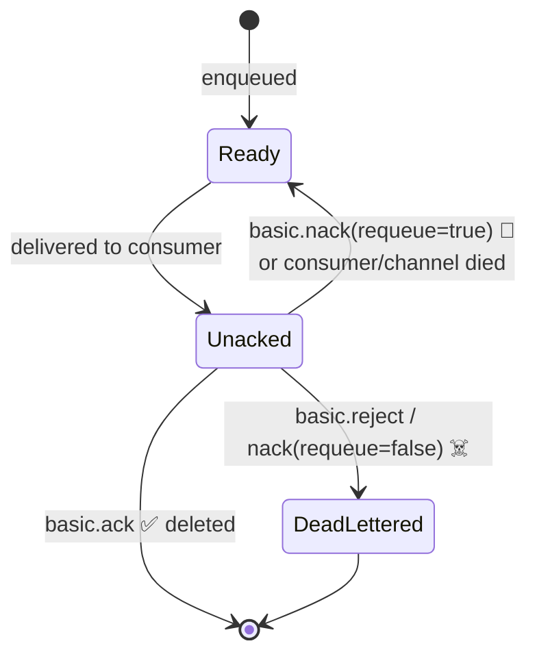
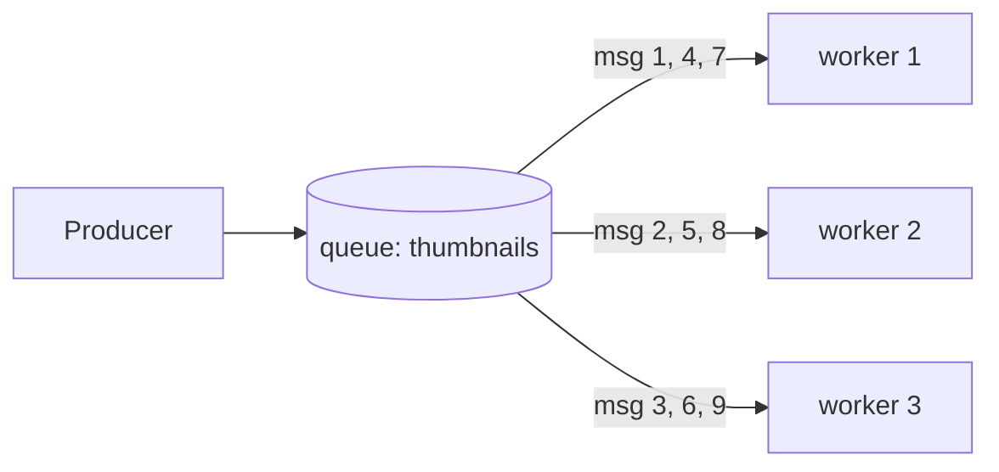

# 03 · Queues & Consumers 🟡

[← Exchanges & Routing](02-exchanges-routing.md) · [Next: Reliability Patterns →](04-reliability-patterns.md)

## 📥 Queue Types

| Type | Replicated | Best for | Notes |
|------|:---------:|----------|-------|
| **Classic** | ❌ (single node) | Temporary, exclusive or non-critical queues | Mirroring was **removed in 4.0** |
| **Quorum** ⭐ | ✅ Raft | **Default for durable, important data** | Poison-message handling (delivery limit) |
| **Stream** | ✅ Raft | Large fan-out, **replay**, huge backlogs | Append-only log, non-destructive reads |

```python
ch.queue_declare("payments", durable=True, arguments={"x-queue-type": "quorum"})
ch.queue_declare("audit",    durable=True, arguments={"x-queue-type": "stream"})
```

## 💾 Durability: Three Things Must Line Up

```
   ┌───────────────────┐   ┌───────────────────┐   ┌─────────────────────────┐
   │ durable EXCHANGE  │ + │ durable QUEUE     │ + │ PERSISTENT MESSAGE      │
   │ (survives restart)│   │ (survives restart)│   │ delivery_mode=2         │
   └───────────────────┘   └───────────────────┘   └─────────────────────────┘
                 = message survives a broker restart ✅
   (quorum queues & streams always persist messages)
```

| Queue property | Meaning |
|----------------|---------|
| `durable` | Definition survives a broker restart |
| `exclusive` | Belongs to one connection, deleted when it closes (temp reply queues) |
| `auto-delete` | Deleted when the last consumer leaves |
| `x-max-length` / `x-max-length-bytes` | Cap size; `x-overflow`: `drop-head` (default) or `reject-publish` |
| `x-message-ttl` | Messages expire after N ms |
| `x-dead-letter-exchange` | Where rejected or expired messages go (ch. 04) |

## ✅ Consumer Acknowledgements



| Mode | Behavior | Risk |
|------|----------|------|
| **auto-ack** (`auto_ack=True`) | Considered done as soon as it is sent | ❌ Lost if the consumer crashes mid-processing |
| **manual ack** ✅ | You ack after processing succeeds | Duplicates possible after a crash, so be **idempotent** |

```python
def handle(ch, method, props, body):
    try:
        process(body)
        ch.basic_ack(method.delivery_tag)
    except TransientError:
        ch.basic_nack(method.delivery_tag, requeue=True)    # try again
    except Exception:
        ch.basic_nack(method.delivery_tag, requeue=False)   # → dead-letter

ch.basic_qos(prefetch_count=20)
ch.basic_consume("payments", on_message_callback=handle)
ch.start_consuming()
```

> ⚠️ Forgetting to ack = messages pile up as **unacked** and get redelivered when the consumer disconnects. Watch the "Unacked" count in the UI.

## 🚰 Prefetch (QoS): Flow Control for Consumers

```
 prefetch_count = how many UNACKED messages a consumer may hold at once

 prefetch=1    🐇 ─▶ [m] consumer        safest, fair, slow (one round trip per message)
 prefetch=20   🐇 ─▶ [mmmmmmmmmm...]      ✅ good default range: 10–300
 unlimited     🐇 ─▶ [mmmmmmmmmmmmmmmm…]  ❌ one consumer hoards everything, RAM blows up
```

## ⚖️ Competing Consumers (Work Queue)



- Messages go **round-robin** among consumers, limited by prefetch.
- Scale throughput by **adding consumers**.
- Ordering is only guaranteed **per queue with a single consumer**. Use `x-single-active-consumer` if you need one active consumer with hot standbys.

## 📮 Publisher Confirms: Reliability on the Publish Side

```mermaid
sequenceDiagram
    participant P as Publisher
    participant B as Broker
    P->>B: confirm.select (enable once per channel)
    P->>B: publish #1, #2, #3 (async, batched)
    B-->>P: ack #1..#2 ✅ (persisted / replicated)
    B-->>P: nack #3 ❌ → republish
    Note over P: track outstanding seq numbers;<br/>retry on nack or timeout
```

```
  Without confirms: publish() returns → message could still be lost 🕳️
  With confirms:    broker ack = it's safely in the queue(s) ✅
```

> 💡 For quorum queues, the confirm arrives once a **majority of replicas** have written the message. Publish asynchronously and handle confirms in batches for throughput.

## 🔒 End-to-End Delivery Guarantee

```
 Producer ──[confirms]──▶ Broker ──[durable + persistent / quorum]──▶ Consumer ──[manual ack]
   ✔ not lost in transit      ✔ survives restarts & node loss          ✔ not lost while processing

 = AT-LEAST-ONCE delivery  →  make consumers IDEMPOTENT (ch. 04)
```

## ✅ Key Takeaways

- Use **quorum queues** for important data, **streams** for replay and fan-out, and classic queues for temporary data.
- Durable exchange + durable queue + persistent message (or quorum/stream) = survives restarts.
- **Manual ack + sensible prefetch** on consumers, **publisher confirms** on producers.
- The result is **at-least-once** delivery, so design for duplicates.
