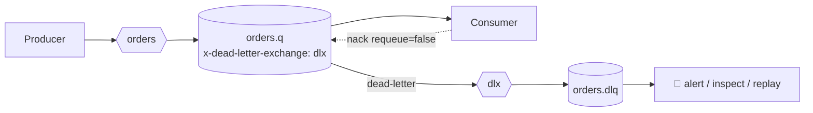
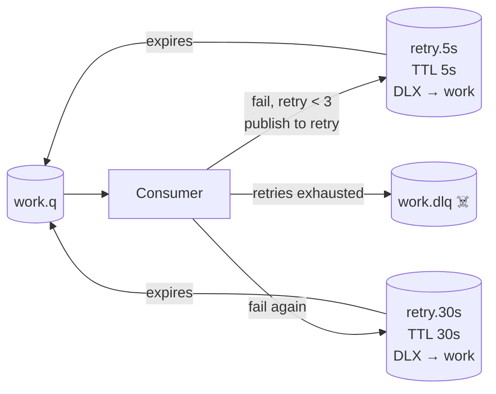
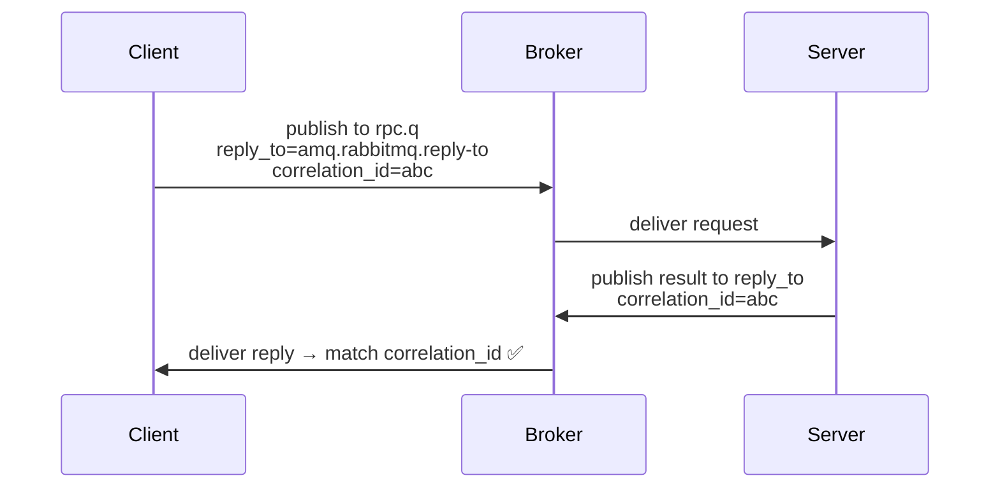
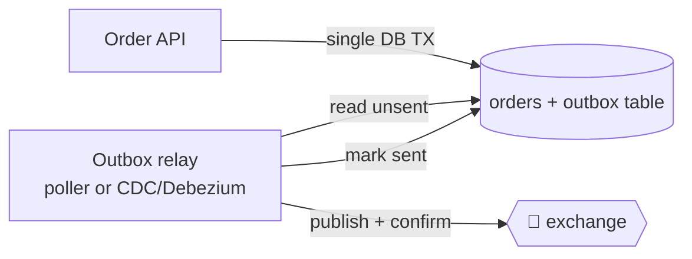

# 04 · Reliability Patterns 🟡

[← Queues & Consumers](03-queues-consumers.md) · [Next: Clustering & HA →](05-clustering-ha.md)

## ☠️ Dead Letter Exchanges (DLX)

A message is **dead-lettered** when it is:

1. rejected or nacked with `requeue=false`
2. expired (TTL)
3. dropped because the queue is full (`x-max-length`)
4. over the quorum queue **delivery limit** (default **20** in RabbitMQ 4.x)



```python
ch.exchange_declare("dlx", "fanout", durable=True)
ch.queue_declare("orders.dlq", durable=True, arguments={"x-queue-type": "quorum"})
ch.queue_bind("orders.dlq", "dlx")

ch.queue_declare("orders.q", durable=True, arguments={
    "x-queue-type": "quorum",
    "x-dead-letter-exchange": "dlx",
    "x-delivery-limit": 5,          # poison-message protection
})
```

> 💡 Prefer **policies** over queue arguments for DLX, TTL and limits, because policies can change without redeclaring queues:
> `rabbitmqctl set_policy DLX "^orders\." '{"dead-letter-exchange":"dlx"}' --apply-to queues`

## 🔁 Retry with Backoff (Delay Queues)

Don't requeue instantly in a hot loop. Park failures in a **wait queue** whose TTL sends them back.



```
  attempt 1 ❌ → wait 5s → attempt 2 ❌ → wait 30s → attempt 3 ❌ → parking lot (DLQ)
  track attempts in a header: x-retry-count (or read x-death)
```

| Delay option | Notes |
|--------------|-------|
| TTL + DLX queues (above) | No plugin needed. One queue per delay tier |
| `rabbitmq_delayed_message_exchange` plugin | `x-delay` header per message. Not replicated, so avoid it for critical data at scale |
| Scheduler outside the broker | DB or cron for long delays (hours or days) |

## ⏳ TTL & Expiry

```
  per queue   x-message-ttl: 60000      → every message expires after 60s
  per message expiration: "60000"       → only that message
  queue TTL   x-expires: 1800000        → the queue itself is deleted when unused for 30 min
```

> ⚠️ In classic queues, per-message TTL is only applied at the **head** of the queue, so expired messages behind live ones wait their turn.

## 🥇 Priority Queues

```python
ch.queue_declare("jobs", durable=True, arguments={"x-max-priority": 5})  # classic queue
ch.basic_publish("", "jobs", body, pika.BasicProperties(priority=5))
```

```
  queue: [p5][p5][p3][p1][p1]  → higher priority delivered first
  ⚠️ keep the number of levels small (≤ 5–10). Priority only helps when a backlog exists.
  (quorum queues in 4.x support two levels, normal and high)
```

## 📞 RPC (Request / Reply)



> 💡 Use **Direct Reply-to** (`amq.rabbitmq.reply-to`) so you don't create a reply queue per request. Always set a client-side **timeout**.

## 🧾 Idempotent Consumers

At-least-once delivery means **duplicates will happen** (redelivery after a crash, publisher retries).

```
 message_id: 7f3a  ──▶ consumer
                         │
                         ├─ seen 7f3a in processed_ids?  → ✅ yes → just ack, skip
                         └─ no → BEGIN TX
                                  apply business change
                                  INSERT processed_ids(7f3a)   (unique constraint)
                                 COMMIT → ack
```

Other tools: natural idempotency (`SET status='paid'` rather than `balance += 10`) and upserts.

## 📤 Transactional Outbox (Publishing Reliably from a DB)

The problem: "save the order, then publish" can fail halfway, so you get an order with no event, or an event with no order.



## 🧩 Pattern Summary

| Problem | Pattern |
|---------|---------|
| Distribute heavy work | Work queue (competing consumers) |
| Broadcast events | Fanout or topic pub/sub |
| Bad or poison messages | DLX + delivery limit + DLQ alerting |
| Temporary failures | Retry queues with exponential backoff |
| Request/response | RPC with Direct Reply-to + timeout |
| Duplicates | Idempotent consumer (dedupe by `message_id`) |
| DB + message consistency | Transactional outbox |
| Strict ordering | One queue + single active consumer (or partition with the consistent-hash exchange) |

## ✅ Key Takeaways

- Always configure a **DLX/DLQ**, and alert when it isn't empty.
- Retry with **backoff** through TTL queues, never in a tight requeue loop.
- **Idempotency** is mandatory with at-least-once delivery.
- Use the **outbox** to publish consistently with database writes.
