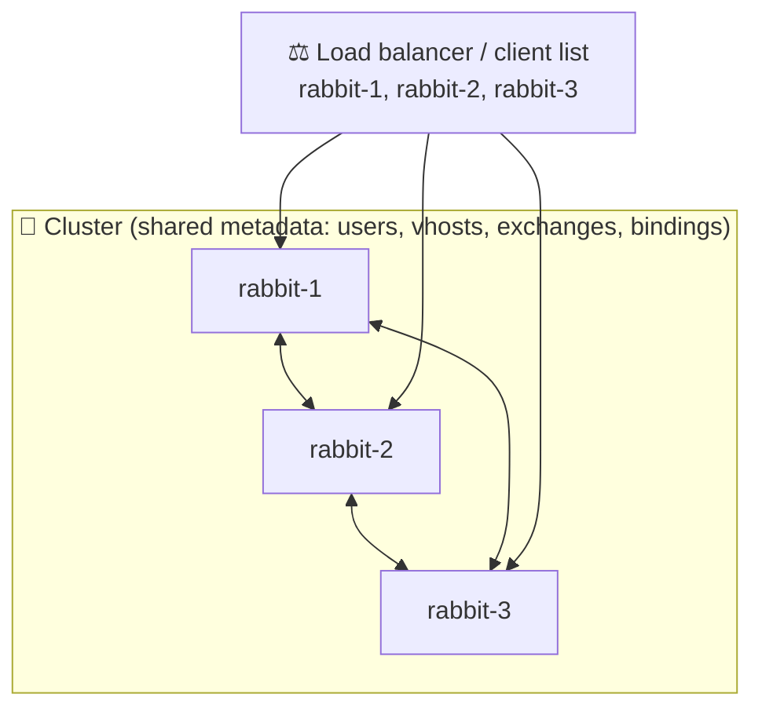
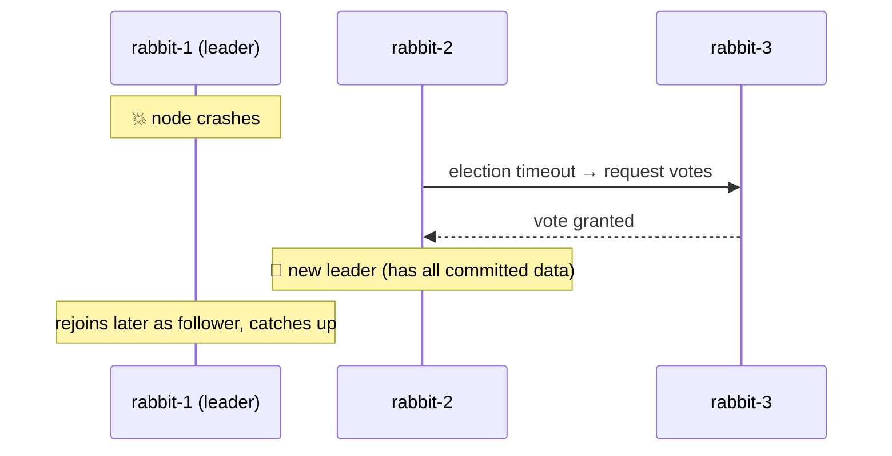
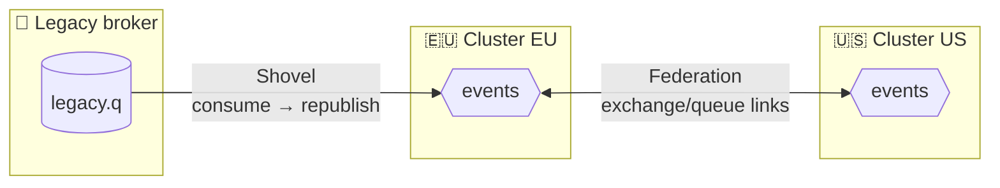

# 05 · Clustering & High Availability 🔴

[← Reliability Patterns](04-reliability-patterns.md) · [Next: Operations & Security →](06-operations-security.md)

## 🕸️ A RabbitMQ Cluster



- **Metadata** (exchanges, bindings, users, policies) is replicated to **all** nodes. RabbitMQ 4.x moves this to **Khepri**, a Raft-based store that replaces Mnesia.
- **Queue contents** live only where the queue type puts them. Classic queues live on **one** node, while quorum queues and streams are **replicated**.
- Use an **odd number of nodes** (3 or 5) so a majority (quorum) can survive failures.
- Clients can connect to any node, which forwards traffic internally.

## 🗳️ Quorum Queues (Raft)

```
                 publish
                    │
          ┌─────────▼─────────┐
          │  LEADER (rabbit-1) │ ── replicate ──┬──────────────────────┐
          └───────────────────┘                 ▼                      ▼
                                       FOLLOWER (rabbit-2)    FOLLOWER (rabbit-3)
                                              ✅ written              ⏳

   2 of 3 written (majority) → message COMMITTED → publisher confirm sent ✅
```

### Failover



| Cluster size | Replicas | Tolerates losing |
|:---:|:---:|:---:|
| 3 nodes | 3 | 1 node |
| 5 nodes | 5 (or 3) | 2 nodes |

```
  ⚠️ Quorum queues favor CONSISTENCY over availability:
     lose the majority → the queue becomes unavailable (it won't accept writes it can't replicate).
```

## 🌊 Streams

An append-only, replicated **log** inside RabbitMQ (similar in spirit to Kafka).

```
  stream: audit-events
  ┌────┬────┬────┬────┬────┬────┬────┬────┐
  │ 0  │ 1  │ 2  │ 3  │ 4  │ 5  │ 6  │ 7  │ ──▶ appended
  └────┴────┴────┴────┴────┴────┴────┴────┘
     ▲              ▲                   ▲
  consumer A     consumer B          consumer C
  offset=first   offset=3            offset=next (live tail)

  ✔ reading doesn't delete     ✔ replay from any offset or timestamp
  ✔ many consumers, one copy   ✔ retention by size/age (max-length-bytes, max-age)
```

| Use streams for | Use quorum queues for |
|-----------------|------------------------|
| Huge fan-out (same data to many consumers) | Work distribution, each message processed once |
| Replay and time travel | Per-message ack, DLX, redelivery |
| Very large backlogs (millions of messages) | Classic task-queue semantics |

> 💡 **Super streams** partition a stream into several streams for horizontal scale, with ordering kept per partition key.

## 🌍 Connecting Brokers: Federation vs Shovel



| | Federation | Shovel |
|--|-----------|--------|
| What | Links exchanges or queues across brokers, pulled on demand | Moves messages from a source to a destination |
| Coupling | Loose, works over a WAN, tolerates partitions | Point-to-point |
| Use | Multi-region event distribution | Migrations, bridging, draining queues |

> Clusters are for a **LAN** (low latency). Use **federation or shovel across data centers**, not a stretched cluster.

## 🔌 Client-Side HA

```
  ✔ give clients a list of nodes (or a load balancer / DNS name)
  ✔ enable automatic connection recovery + topology recovery
  ✔ heartbeats (default 60s) to detect dead TCP connections
  ✔ publisher confirms + retry on failover
  ✔ consumers: idempotent, because redeliveries happen after failover
```

## 🧱 Network Partitions

```
  split brain:  [rabbit-1] ✂️ [rabbit-2, rabbit-3]
  quorum queues → the majority side keeps working, the minority side stops ✅ safe
  partition_handling = pause_minority  (recommended for classic metadata clusters)
```

## ☸️ Deploying a Cluster

| Option | Notes |
|--------|-------|
| **RabbitMQ Cluster Operator** (Kubernetes) ⭐ | `RabbitmqCluster` CRD. Handles peers, PVCs, rolling upgrades |
| VMs + config management | Peer discovery: classic config, DNS, Consul, etcd, AWS |
| Managed | Amazon MQ, CloudAMQP, and others |

```yaml
apiVersion: rabbitmq.com/v1beta1
kind: RabbitmqCluster
metadata: { name: shop-rabbit }
spec:
  replicas: 3
  persistence: { storage: 20Gi }
  resources:
    requests: { cpu: "1", memory: 2Gi }
    limits:   { memory: 2Gi }
```

## ✅ Key Takeaways

- Run clusters of **3 or 5** nodes. Metadata is everywhere, and queue data is replicated only for quorum queues and streams.
- **Quorum queues** use Raft: majority commit, automatic leader failover, consistency first.
- **Streams** add Kafka-like replayable logs inside RabbitMQ.
- Cross-region: **federation/shovel**, not stretched clusters.
