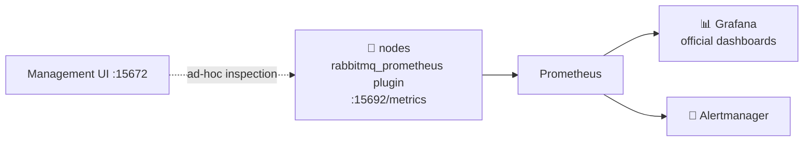

# 06 · Operations & Security 🔴

[← Clustering & HA](05-clustering-ha.md) · [Next: Cheatsheet →](07-cheatsheet.md)

## 🔭 Monitoring



| Metric | Watch for | Why |
|--------|-----------|-----|
| **Queue depth** (ready) | Steady growth 📈 | Consumers can't keep up |
| **Unacked** messages | High or stuck | Consumers stuck or missing acks |
| Publish vs deliver/ack rate | Publish > ack for a long time | Backlog building |
| **Consumers per queue** | Drops to 0 | Messages pile up silently |
| **DLQ depth** | > 0 | Failing or poison messages |
| Memory and disk alarms | Triggered | Publishers **blocked** |
| Connection/channel count + churn | Spikes | Connection leak (connect per message) |
| File descriptors, Erlang processes | Near the limit | Capacity issue |

## 🚨 Resource Alarms & Flow Control

```
 memory used  ─────────────────────────────[ vm_memory_high_watermark (0.6) ]──▶ 🚫 BLOCK publishers
 disk free    ◀─[ disk_free_limit ]──────────────────────────────────────────── 🚫 BLOCK publishers

 publishers: connection.blocked → wait     consumers: keep consuming ✅ (drains the backlog)
```

> 💡 This is why publishers and consumers should use **separate connections**: a blocked publishing connection then can't stall consumption.

## ⚙️ Performance & Tuning

| Lever | Guidance |
|-------|----------|
| Prefetch | 10–300, tune by latency and processing time |
| Message size | Keep small (KBs). Put large blobs in object storage and send a reference (claim-check) |
| Queue length | **Short queues are fast queues.** Huge backlogs cost memory and disk IO |
| Queue count | Thousands are fine. Spread load across nodes (one queue = one leader) |
| Connections | Long-lived, few. Pool channels |
| Publishing | Async confirms in batches, not sync one by one |
| Throughput needs | Streams / super streams for very high rates or fan-out |
| Lazy behavior | Classic queues v2 and quorum queues page to disk efficiently by default |

## 🔐 Security

```
 ┌──────────────── Defense layers ────────────────┐
 │ 🌐 Network   private subnets, firewall 5672/5671, 15672, 25672, 4369
 │ 🔒 TLS       amqps://:5671, mgmt over HTTPS, inter-node TLS
 │ 🪪 AuthN     users/passwords, x509 client certs, OAuth 2.0 / OIDC, LDAP
 │ 📜 AuthZ     per-vhost configure / write / read regex permissions, topic permissions
 │ 🧾 Audit     event exchange plugin, logs
 └─────────────────────────────────────────────────┘
```

### Least-privilege permissions

```bash
rabbitmqctl add_vhost shop
rabbitmqctl add_user order-api 'S3cure!'
#                                           configure        write      read
rabbitmqctl set_permissions -p shop order-api "^$"         "^orders$"  "^$"
#   → can only PUBLISH to exchange "orders", can't declare or consume anything

rabbitmqctl add_user email-worker 'S3cure2!'
rabbitmqctl set_permissions -p shop email-worker "^$" "^$" "^email\.q$"
rabbitmqctl delete_user guest            # 🔥 remove the default user in prod
```

| Do ✅ | Don't ❌ |
|------|---------|
| One user per app, one vhost per environment or tenant | Share one admin user everywhere |
| TLS everywhere, rotate credentials (Vault, OAuth) | Expose 15672 to the internet |
| Restrict management tags (`monitoring` vs `administrator`) | Use `guest` remotely |
| Protect the **Erlang cookie** (cluster secret) | Commit `.erlang.cookie` to git |

## 📐 Configuration

```ini
# rabbitmq.conf
listeners.tcp = none                      # TLS only
listeners.ssl.default = 5671
ssl_options.cacertfile = /etc/rabbitmq/ca.pem
ssl_options.certfile   = /etc/rabbitmq/server.pem
ssl_options.keyfile    = /etc/rabbitmq/server-key.pem
vm_memory_high_watermark.relative = 0.6
disk_free_limit.absolute = 5GB
default_queue_type = quorum               # vhost-level default
cluster_partition_handling = pause_minority
```

### Topology as code (definitions)

```bash
rabbitmqctl export_definitions /backup/defs.json   # exchanges, queues, bindings, users, policies
rabbitmqctl import_definitions /backup/defs.json
```

Or manage the same objects declaratively with **Terraform** or the **Messaging Topology Operator** (Kubernetes CRDs: `Queue`, `Exchange`, `Binding`, `User`, `Permission`).

## 🐳 Local Cluster with Docker Compose

```yaml
services:
  rabbit:
    image: rabbitmq:4-management
    hostname: rabbit
    ports: ["127.0.0.1:5672:5672", "127.0.0.1:15672:15672"]
    environment:
      RABBITMQ_DEFAULT_USER: admin
      RABBITMQ_DEFAULT_PASS: change-me
    volumes: ["rabbit-data:/var/lib/rabbitmq"]
    healthcheck:
      test: ["CMD", "rabbitmq-diagnostics", "-q", "ping"]
      interval: 10s
      retries: 5
volumes:
  rabbit-data:
```

## 🔄 Upgrades

```
 ✔ read the release notes and check deprecated features (rabbitmq-diagnostics check_if_any_deprecated_features_are_used)
 ✔ enable all feature flags before the next upgrade
 ✔ rolling upgrade one node at a time (quorum queues stay available)
 ✔ blue/green with a new cluster + shovel/federation for major jumps
```

## ✅ Key Takeaways

- Monitor **queue depth, unacked, consumers, DLQ and alarms** with Prometheus + Grafana.
- Memory and disk alarms **block publishers**, so separate publisher and consumer connections.
- Keep messages small and queues short. Use streams for very high throughput.
- Secure with **TLS, per-app users, least-privilege vhost permissions**, and delete `guest`.
